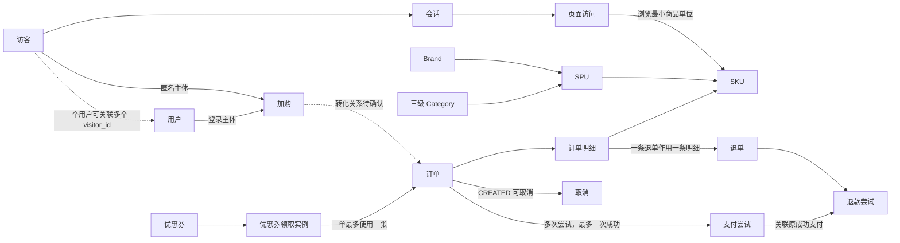

# Milestone 2 业务设计

版本：`1.2-draft`

状态：Milestone 2 `in progress`；M2.1 `completed`；M2.2 `in progress`

更新时间：2026-09-11

适用决策：`DR-008` 至 `DR-020`

## 1. 文档定位与证据边界

本文档是 Milestone 2 的正式业务设计文档，也是 M2.1 至 M2.5 的业务语义事实来源。Milestone 1 与 Milestone 2 当前均为 `in progress`：M1 继续组件安装与验证，M2 按 `docs/plan.md` 的 M2.1 至 M2.5 小计划推进。`M2-DEC-001` 至 `014` 已由用户确认，M2.1 已完成；M2.2 已确认 19 张 MySQL 源表、公共物理规范及约束分工，并完成全部 19 张源表共 230 个字段的可空性、关系、单行约束和索引方向设计。候选 DDL 尚未生成或执行。

本文档只依据当前仓库的 `README.md`、`docs/spec.md`、`docs/plan.md` 和已接受决策，不引用旧仓库候选实现。当前没有执行 MySQL、没有创建业务表、没有生成固定数据，也没有验证任何主外键、状态迁移、金额或指标结果。

按小计划执行时：

- M2.1 已完成；M2.2 可以基于已确认语义设计表名、字段、类型、主外键、状态、索引和候选 DDL；未执行 MySQL 前最多标记为 `implemented`。
- M2.2 通过后，M2.3 和 M2.4 可以在本地并行准备固定 seed、预期结果、数据生成器和 Targeted Test。
- M2.5 必须等待 M1 的 MySQL 门禁通过；不得因本地代码或静态检查宣称 MySQL 验收通过。
- 不根据指标名称反推并采用业务规则；缺失内容统一标记 `DECISION_REQUIRED`。

## 2. 业务过程与正式指标需求矩阵

下表只说明 30 项正式指标需要哪些业务过程提供语义输入，不定义公式、时间归属、去重对象或过滤条件。

| 主题 | 待评审业务过程 | 关联正式指标 | 当前缺口 |
| --- | --- | --- | --- |
| 流量 | 渠道访问、会话开始与结束、页面访问、首页访问、商品详情访问 | `P1_METRIC_001` 各渠道独立访客数；`P1_METRIC_002` 各渠道会话总数；`P1_METRIC_003` 各渠道会话平均浏览页数；`P1_METRIC_004` 各渠道会话平均停留时长；`P1_METRIC_005` 各渠道跳出率；`P1_METRIC_006` 各小时独立访客数；`P1_METRIC_007` 各小时页面浏览数；`P1_METRIC_012` 首页浏览人数；`P1_METRIC_013` 商品详情页浏览人数 | 访客标识、会话边界、跨日切分、渠道归属、页面分类、来源字段和统一时间规则已确认；各指标公式仍待后续设计 |
| 用户 | 注册、登录、用户类型识别、新增、活跃、回流 | `P1_METRIC_008` 各类访客数；`P1_METRIC_009` 回流用户数；`P1_METRIC_010` 新增用户数；`P1_METRIC_011` 活跃用户数 | 身份关联、新老访客、新增/活跃/回流定义已确认；来源字段、最终指标公式和异常数据规则仍待后续设计 |
| 交易 | 加购、下单、支付 | `P1_METRIC_014` 加购人数；`P1_METRIC_015` 下单人数；`P1_METRIC_016` 支付成功人数；`P1_METRIC_017` 新增下单人数；`P1_METRIC_018` 新增支付成功人数 | 加购、订单与支付源字段、粒度、业务键、幂等、状态、人数去重主体、事件时间归属和金额精度已确认；最终过滤与公式仍待指标设计 |
| 商品与交易 | 品牌、品类、SPU 与订单明细的业务关联 | `P1_METRIC_019` 各品牌订单数；`P1_METRIC_020` 各品牌订单金额；`P1_METRIC_022` 各品类订单数；`P1_METRIC_023` 各 SPU 订单数；`P1_METRIC_024` 各 SPU 订单金额 | Brand、三级 Category、SPU、SKU 层级、商品源字段、下单快照、订单明细字段和金额守恒规则已确认；最终指标过滤仍待设计 |
| 退单/退款 | 取消、退单、退款及其与订单、支付的关系 | `P1_METRIC_021` 各品牌退单数；`P1_METRIC_028` 退单数 | 取消、退单与退款已分离，作用范围、累计上限、计数对象、品牌归属、状态机、金额精度、事件时间归属和来源字段已确认；最终指标过滤仍待设计 |
| 交易汇总 | 订单金额、订单数量、下单人数、收货省份 | `P1_METRIC_025` 订单总额；`P1_METRIC_026` 订单数；`P1_METRIC_027` 订单人数；`P1_METRIC_029` 各省份订单金额 | 订单、支付与退款字段、状态、金额组成、时间语义和收货省份快照已确认；订单类指标是否扣减退款和最终有效订单范围仍待指标设计 |
| 营销 | 优惠券领取、使用和补贴 | `P1_METRIC_030` 优惠券补贴率 | 固定金额券、领取实例、状态、金额与有效期快照、支付日统计窗口、毛补贴分子分母、精度和零分母规则及来源字段已确认；运行血缘仍待后续阶段落实 |

覆盖检查：上述矩阵仅覆盖 `P1_METRIC_001` 至 `P1_METRIC_030`。`P1_METRIC_031` 至 `040` 继续保持扩展候选，不进入 M2 V1 实现；五项实时候选仍只保留既有编号，不定义实时语义。

## 3. 概念关系与待细化边界

下图表达已确认业务语义之间的概念关联，不完整表达物理表、基数、主外键或字段。正式 MySQL 源表清单、基础关系与约束分工见第 8 节；下图不能替代逐表字段和候选 DDL。

概念对象的当前设计状态：

| 概念对象 | 已确认内容 | 尚未确认内容 |
| --- | --- | --- |
| 用户、访客 | `visitor_id` 与 `user_id` 分离；登录前不回写；登录后同时保留两个当时可见的标识；用户、地址和访客字段及索引方向 | 跨设备身份合并算法不纳入 M2；候选 DDL 尚待形成 |
| 会话、页面访问 | 30 分钟无活动或跨 `Asia/Shanghai` 自然日切分；渠道取会话首次进入渠道；会话、登录和页面访问字段、页面分类及索引方向 | 候选 DDL 和实时窗口 |
| Brand、Category、SPU、SKU | Brand → SPU → SKU、三级 Category、SKU 最小商品单位、商品字段与索引方向和下单时属性快照 | 候选 DDL 和数仓维度历史策略 |
| 加购 | 一次操作一个 SKU；新增、改量、移除；前后数量、`request_id` 幂等、错误事件标记、事件时主体、字段和索引方向 | 候选 DDL 和实时去重状态 |
| 订单、订单明细 | 注册用户一次结算一个订单头、一种 SKU 一条明细、不拆单、业务键、请求幂等、金额组成、商品快照、字段和索引方向 | 候选 DDL，以及需与支付/退款表共同完成的完整外键名称 |
| 支付 | 一单多次尝试但最多一次成功、不分次支付、业务键、请求与回调幂等、成功人数主体、字段、生成列和索引方向 | 候选 DDL；V1 不增加第三方支付协议字段 |
| 取消、退单、退款 | 未支付取消；退单与退款分离；明细级部分/多次退单和部分/多次退款；数量、金额、时间、累计计算、字段、生成列和索引方向 | 候选 DDL 和写入层实现 |
| 优惠券领取与使用 | 固定金额券、注册用户领取、一单一券、领取实例一次使用、状态机、金额与有效期快照、锁定/释放时间、字段和索引方向及毛补贴归属 | 候选 DDL、写入层实现和净补贴扩展指标 |

## 4. `DECISION_REQUIRED` 决策矩阵

以下决策必须由用户确认；已经确认的项目标记为 `accepted`，其余候选方向只用于说明需要选择的边界，不表示推荐或采用。

| 编号 | 决策主题 | 当前状态 | 已确认结论或待回答问题 | 未确认时阻断 |
| --- | --- | --- | --- | --- |
| `M2-DEC-001` | 用户与访客身份 | `accepted` | 身份分离；一名用户可关联多个访客标识；登录前不回写，登录后同时记录两个标识；登录不切断当前会话 | 已解除该项阻断，用户与流量字段已由 `DR-014` 确认 |
| `M2-DEC-002` | 会话边界 | `accepted` | 30 分钟无活动或跨 `Asia/Shanghai` 自然日切分；渠道取会话首次进入渠道；会话内渠道变化不拆分 | 已解除该项阻断，页面分类和事件字段已由 `DR-014` 确认 |
| `M2-DEC-003` | 用户类型与新增/活跃/回流 | `accepted` | 新老访客按首次访问日；新增用户按注册日；活跃用户按四类带用户标识行为；回流采用连续 7 个完整自然日未活跃规则 | 已解除该项阻断，有效订单和成功支付已由 `DR-011` 确认 |
| `M2-DEC-004` | 商品层级 | `accepted` | Brand → SPU → SKU；三级 Category；SKU 为最小商品单位；订单保存下单时归属快照 | 已解除该项阻断，商品字段已由 `DR-015` 确认 |
| `M2-DEC-005` | 加购粒度 | `accepted` | 一行一次主体对一个 SKU 的操作；记录前后数量；`request_id` 幂等；人数按事件时主体去重 | 已解除该项阻断，正向交易字段已由 `DR-016` 确认，统计窗口仍待指标设计 |
| `M2-DEC-006` | 订单与明细粒度 | `accepted` | 注册用户一次结算一个订单头、一种 SKU 一条明细；V1 不拆单；业务键和请求幂等已确认 | 已解除该项阻断，字段与正向交易约束已由 `DR-016` 确认 |
| `M2-DEC-007` | 支付关系与成功语义 | `accepted` | 一单可多次尝试但最多一次成功；不分次支付；请求和回调幂等；成功人数按 `user_id` 去重 | 已解除该项阻断，支付字段与唯一成功生成列已由 `DR-017` 确认 |
| `M2-DEC-008` | 取消、退单与退款关系 | `accepted` | 未支付订单可取消；退单与退款分离；明细级部分/多次退单及部分/多次退款；累计数量和金额受限 | 已解除该项阻断，退单与退款字段已由 `DR-017` 确认 |
| `M2-DEC-009` | 业务状态机 | `accepted` | 订单、支付尝试、退单、退款尝试的状态、迁移、终态与非法迁移处理已确认 | 已解除该项阻断，支付与逆向交易单行状态约束已由 `DR-017` 确认 |
| `M2-DEC-010` | 硬删除策略 | `accepted` | 核心业务对象禁止硬删除；主数据停用或软删除；交易保留；加购 append-only；不建设全量快照识别删除 | 已解除该项阻断，支付与逆向交易字段已由 `DR-017`、营销字段已由 `DR-018` 确认，运行测试留待后续小计划 |
| `M2-DEC-011` | 时间语义 | `accepted` | `Asia/Shanghai`、毫秒精度、过程事件时间与跨日独立归属；审计时间和到达时间不替代业务时间 | 已解除该项阻断，公共物理类型已由 `DR-013` 确认 |
| `M2-DEC-012` | 金额与数量 | `accepted` | V1 仅 CNY、金额两位小数、`HALF_UP`、含税且运费为零；订单优惠分摊和累计退款规则已确认 | 已解除该项阻断，公共物理类型已由 `DR-013` 确认 |
| `M2-DEC-013` | 优惠券补贴率 | `accepted` | 固定金额券、一单一券、领取实例状态机；`P1_METRIC_030` 按支付日计算毛补贴率，零分母输出 0 | 已解除该项阻断，来源字段已由 `DR-018` 确认，运行血缘留待后续阶段 |
| `M2-DEC-014` | 数据库约束与异常注入 | `accepted` | MySQL 负责结构与单行约束，Python 写入层负责跨行和流程规则；不使用 Trigger/Stored Procedure；异常用独立事务和失败用例隔离 | 已解除该项阻断；字段映射见 8.4 至 8.8，物理命名见 8.9.1 |
| `M2-DEC-015` | 验收数据集规模 | `DECISION_REQUIRED` | 固定数据覆盖多少对象、业务日期和边界组合 | seed 规模、预期结果和人工核对成本 |

### 4.1 已确认结论的实施解释

1. 身份记录以事件发生时可见的标识为准。匿名事件只带 `visitor_id`；登录后的事件同时带 `visitor_id` 和 `user_id`。后续模型不得通过批量回写把登录前事件伪装成当时已经识别用户。
2. 登录不触发会话切分，同一会话可包含登录前后的事件。一个用户跨设备或清理标识后可以对应多个 `visitor_id`，但 M2 不建设自动跨设备合并算法。
3. 会话在相邻事件间隔达到 30 分钟后重新开始；即使未达到 30 分钟，跨 `Asia/Shanghai` 零点也重新开始。渠道维度采用会话第一条事件的进入渠道。
4. 新访客和老访客按 `visitor_id` 首次访问日期判断并互斥。新增用户按注册日期判断；活跃用户要求业务日期内至少一次带 `user_id` 的访问、加购、下单或支付行为。
5. 回流用户必须在本次活跃前连续 7 个完整自然日无活跃行为。新增用户与回流用户互斥，活跃用户集合可包含新增用户和回流用户。
6. 新增下单人数和新增支付成功人数分别使用个人首次有效订单日期与首次成功支付日期；订单和支付状态集合已确认，具体事件时间与跨日归属见 4.4 节。

### 4.2 已确认的商品与正向交易语义

1. Category 采用三级结构，SPU 归属一个 Brand 和一个末级 Category；一个 SPU 可以包含多个 SKU。SKU 是商品详情浏览、加购和交易的最小商品单位。
2. 订单明细保存下单时的 Brand、Category、SPU 和 SKU 归属快照。商品主数据变化不回写历史订单，后续订单指标按下单时快照归属。
3. 一行加购事件代表一个行为主体对一个 SKU 的一次操作，区分新增、修改数量和移除，并记录操作前、操作后数量。相同 `request_id` 只生效一次；数量必须为非负整数，移除后的数量为 0。
4. 加购人数按事件发生时的主体去重：已登录使用 `user_id`，匿名使用 `visitor_id`，不追溯合并登录前匿名行为。
5. V1 只有注册用户可以下单；一次结算生成一个订单头，一种 SKU 生成一条订单明细。一个订单可以有多条明细，但不进行仓库、商家或物流拆单。
6. `order_no` 和 `order_item_no` 分别作为订单头和订单明细业务键。相同下单 `request_id` 的重复提交返回原订单，不创建新订单；订单明细数量必须为正整数。
7. 支付、取消、退单、退款和状态机由 4.3 节补充，时间与金额规则分别见 4.4、4.5 节。

### 4.3 已确认的支付、逆向交易与删除语义

1. 一个订单允许多次支付尝试，但最多一次成功；V1 不支持分次支付。成功支付金额必须等于订单应付金额，金额定义见 4.5 节。
2. 每次支付尝试使用独立 `payment_no`，相同 `request_id` 只创建一次。重复回调不得重复记成功，也不得修改首次 `paid_at`。支付成功人数按 `paid_at` 所属业务日期对 `user_id` 去重。
3. 未支付的 `CREATED` 订单可以取消；支付成功后不能取消，只能进入退单与退款流程。
4. 退单业务单与资金退款分离。一条退单作用于一条订单明细，支持部分数量和多次退单，累计退单数量不得超过购买数量。退单数以 `COMPLETED` 退单业务单为基础，商品归属使用原订单明细快照。
5. 退款关联退单、原订单和原成功支付，支持多次部分退款；累计成功退款金额不得超过成功支付金额。
6. 支付或退款尝试失败后，重试必须创建新的业务尝试记录。非法状态迁移必须拒绝且不修改原记录；每次合法状态变化必须更新 `update_time`。
7. 用户、商品、订单、支付、退单、退款和优惠券禁止业务硬删除。主数据采用停用或软删除，交易数据保留；加购事件 append-only，错误事件使用有效性标记。停用或软删除必须更新 `update_time`。
8. V1 不建设周期性全量快照识别硬删除。固定测试数据只允许在隔离测试库整体重建，不能把测试清理解释成业务删除。

### 4.4 已确认的时间语义

1. 所有业务时间统一按 `Asia/Shanghai` 解释并保留毫秒精度；具体 MySQL 字段类型在 M2.2 确定。
2. 业务日期必须由对应业务事件时间计算，禁止使用任务执行日期代替：页面访问使用 `event_time`，加购使用 `action_time`，订单使用 `ordered_at`，支付使用首次成功的 `paid_at`，取消使用 `cancelled_at`，退单完成使用 `completed_at`，退款成功使用 `refunded_at`，用户注册使用 `registered_at`。
3. 跨日业务过程按各自事件时间独立归属。例如前一日下单、后一日支付时，订单归属下单日，支付归属支付日；后续取消、退单和退款同样不回写前序事件的业务日期。
4. 记录创建与更新时间属于审计时间，逻辑上使用 `create_time`、`update_time`；它们不作为指标业务时间。每次合法状态迁移必须更新 `update_time`，重复回调不得修改首次成功业务时间。
5. 数据到达时间与业务事件时间分开保存。迟到数据仍按事件时间归属业务日期；迟到处理、Watermark 和实时补偿规则继续留到 Milestone 8。

### 4.5 已确认的金额与数量语义

1. V1 只支持人民币 `CNY`。金额保留两位小数并使用 `HALF_UP` 舍入；具体数据库类型在 M2.2 确定。商品价格为含税价格，V1 不单独计算税额，运费固定为 `0.00`。
2. 商品数量必须是正整数；金额、优惠和退款金额不得为负。明细原价金额等于商品单价乘以购买数量，订单原价金额等于全部明细原价金额之和。
3. 订单应付金额等于订单原价金额减去商品优惠金额和优惠券优惠金额。优惠总额不得超过订单原价金额；违反该规则时拒绝创建订单，不自动截断为零。
4. 订单级商品优惠和优惠券优惠分别按明细原价金额比例分摊。两位小数舍入后的尾差，按明细原价金额降序、再按 `order_item_no` 升序依次分配，保证明细分摊合计与订单优惠金额一致。明细应付金额等于明细原价金额减去该明细分摊的全部优惠，全部明细应付金额之和必须等于订单应付金额。
5. 成功支付金额必须等于订单应付金额，不支持拆分支付、超额支付或不足额支付。
6. 部分退货按同一订单明细累计计算：累计可退金额等于 `ROUND(明细应付金额 × 累计完成退货数量 ÷ 购买数量, 2)`，本次退款金额等于累计可退金额减去该明细此前成功退款金额。累计完成退货数量和累计成功退款金额均不得超过原购买数量和明细应付金额。
7. 当成功退款金额大于零且小于订单应付金额时，订单进入 `PARTIALLY_REFUNDED`；累计成功退款金额等于订单应付金额时进入 `REFUNDED`。全部商品完成退款后，累计成功退款金额必须等于订单应付金额。

### 4.6 已确认的优惠券与补贴率语义

1. V1 只支持固定金额优惠券，可以设置最低订单原价金额。只有注册用户可以领取和使用优惠券；一个订单最多使用一张优惠券，一个领取实例最多成功使用一次。
2. 优惠券领取实例使用 `CLAIMED`、`LOCKED`、`USED`、`EXPIRED` 状态。允许 `CLAIMED → LOCKED → USED`、`CLAIMED → EXPIRED`；未支付订单取消时，未过期实例允许 `LOCKED → CLAIMED`，已经过期则 `LOCKED → EXPIRED`。
3. 优惠券有效期在订单锁券时检查。合法锁定后，即使支付时已超过有效期，也不使该订单上的锁券失效。支付成功后实例进入 `USED`；已支付订单后续发生退单或退款时不返还优惠券。
4. `P1_METRIC_030` 定义为按支付业务日期统计的优惠券毛补贴率。分子为当日成功支付订单的优惠券优惠金额之和，分母为同一批订单的商品原价金额之和；后续退款不追溯修改该指标。
5. `P1_METRIC_030` 的分母为零时输出 `0`。比率保留 4 位小数，百分比展示保留 2 位小数，统一使用 `HALF_UP`。净补贴率不纳入 V1，可在正式 30 项指标完成后作为扩展候选重新评审。

## 5. 已确认状态机

| 对象 | 状态 | 允许迁移 | 终态或稳定状态 | 必须覆盖的异常 |
| --- | --- | --- | --- | --- |
| 订单 | `CREATED`、`PAID`、`CANCELLED`、`PARTIALLY_REFUNDED`、`REFUNDED` | `CREATED → PAID`；`CREATED → CANCELLED`；`PAID → PARTIALLY_REFUNDED`；`PAID → REFUNDED`；`PARTIALLY_REFUNDED → REFUNDED` | `CANCELLED`、`REFUNDED` 为终态；`PAID` 可作为无逆向交易时的稳定状态 | 已支付后取消、终态后变更、退款状态与成功退款累计不一致 |
| 支付尝试 | `CREATED`、`SUCCESS`、`FAILED` | `CREATED → SUCCESS`；`CREATED → FAILED` | `SUCCESS`、`FAILED` 均为单次尝试终态 | 无订单支付、同单第二次成功、重复回调改变成功时间、失败记录改回成功 |
| 退单 | `APPLIED`、`APPROVED`、`REJECTED`、`COMPLETED` | `APPLIED → APPROVED`；`APPLIED → REJECTED`；`APPROVED → COMPLETED` | `REJECTED`、`COMPLETED` 为终态 | 超购买数量、无明细、无成功退款却完成、终态后变更 |
| 退款尝试 | `CREATED`、`SUCCESS`、`FAILED` | `CREATED → SUCCESS`；`CREATED → FAILED` | `SUCCESS`、`FAILED` 均为单次尝试终态 | 无退单退款、无成功支付退款、累计成功金额超限、失败记录改回成功 |
| 加购 | 采用新增、修改数量和移除事件，不使用生命周期状态机 | 每次事件独立记录操作前后数量 | append-only | 负数、重复请求、无 SKU、修改前后数量不一致 |
| 优惠券领取实例 | `CLAIMED`、`LOCKED`、`USED`、`EXPIRED` | `CLAIMED → LOCKED`；`LOCKED → USED`；`CLAIMED → EXPIRED`；未支付订单取消后 `LOCKED → CLAIMED` 或 `LOCKED → EXPIRED` | `USED`、`EXPIRED` 为终态 | 重复使用、过期后新锁定、无领取记录使用、同一实例关联多个支付成功订单 |

所有非法迁移必须拒绝并保持原记录不变；正常 seed 与异常注入数据必须隔离。MySQL 负责结构和单行约束，跨行累计及流程规则由 Python 写入层负责，具体边界见 8.3 节。

## 6. 固定验收场景矩阵

当前只确定场景目的和未来必须核对的不变量，不提供数据行、精确数量或指标结果。所有预期值必须在业务决策通过后补充。

| 场景编号 | 场景 | 未来固定输入必须覆盖 | 未来预期约束 |
| --- | --- | --- | --- |
| `M2-SC-001` | 正常闭环 | 注册或访客访问、浏览、加购、下单、支付 | 引用完整，状态和金额按确认规则守恒 |
| `M2-SC-002` | 订单取消 | 下单后发生允许的取消 | 生效范围和指标影响与确认规则一致 |
| `M2-SC-003` | 退单/退款 | 全量或部分退单/退款候选情形 | 累计完成退货数量和累计成功退款金额按明细计算且不超过确认边界，关系可追溯 |
| `M2-SC-004` | 重复业务请求 | 相同业务键或请求被重复提交 | 唯一性、幂等或保留重复的行为与确认规则一致 |
| `M2-SC-005` | 跨日过程 | 下单、支付、取消、退单或退款分属不同业务日期 | 各过程按自身事件时间和 `Asia/Shanghai` 业务日期独立归属 |
| `M2-SC-006` | 非法状态迁移 | 从不允许的前态触发迁移 | 明确拒绝、隔离或记录方式，不污染正常数据 |
| `M2-SC-007` | 主外键缺失 | 订单无用户、明细无商品等候选异常 | 独立事务触发外键拒绝并回滚，不进入正常 seed |
| `M2-SC-008` | 空值边界 | 可空和不可空业务属性的候选样例 | 空值范围与正式字段规则一致 |
| `M2-SC-009` | 金额和舍入边界 | 两位小数、优惠分摊尾差、部分退款、全额退款和零应付候选样例 | 按 `HALF_UP`、确定性尾差顺序和累计退款公式守恒 |
| `M2-SC-010` | 用户属性变化 | 用户或商品属性在业务过程前后发生变化 | 当前值或历史值归属与确认策略一致 |
| `M2-SC-011` | 零分母 | 没有成功支付订单原价金额但需要输出优惠券补贴率的日期 | `P1_METRIC_030` 输出 `0`，同时保留分子和分母供核对 |
| `M2-SC-012` | 优惠券异常 | 重复使用、过期后锁券、无领取记录使用、未支付取消释放及支付后退款候选情形 | 状态迁移、一单一券、实例一次使用和支付后不返还规则一致 |

## 7. 用户评审顺序

按下列顺序评审，前一组未确认时不继续推导后续物理模型：

1. `P0` 身份与流量：`M2-DEC-001` 至 `003` 已确认。
2. `P0` 商品与正向交易：`M2-DEC-004` 至 `006` 已确认。
3. `P0` 支付与逆向交易：`M2-DEC-007` 至 `010` 已确认。
4. `P0` 时间与金额：`M2-DEC-011`、`012` 已确认。
5. `P1` 营销：`M2-DEC-013` 已确认；M2.1 完成。
6. `P1` OLTP 模型：当前执行 M2.2，基于已确认语义设计逻辑对象、字段、关系、索引、约束和候选 DDL。
7. `P1` 验收设计：`M2-DEC-014` 已确认；进入 M2.3 前继续确认 `M2-DEC-015`，再为 `M2-SC-001` 至 `012` 填写固定输入和预期结果。

## 8. M2.2 OLTP 源表与约束基线

### 8.1 MySQL 源表清单

以下 19 张表属于 MySQL 数据库 `ecommerce_oltp` 的 OLTP 业务源表，不是 Hive ODS、DIM/DWD、DWS 或 ADS 表。表名、职责、基础关系及全部 230 个字段已确认；完整可命名约束/索引台账、生成列物理形式及建表顺序已按 `DR-020` 收口，候选 DDL 继续在 M2.2 完成。

| 主题 | 源表 | 一行代表什么 |
| --- | --- | --- |
| 用户与流量 | `user_account` | 一个注册用户账户 |
| 用户与流量 | `user_address` | 一个用户维护的一条收货地址 |
| 用户与流量 | `visitor` | 一个匿名访客标识 |
| 用户与流量 | `traffic_channel` | 一个可归因的流量渠道 |
| 用户与流量 | `visit_session` | 一个访客在确认会话规则下形成的一次会话 |
| 用户与流量 | `login_event` | 一个访客在一次会话中的一次用户登录事件 |
| 用户与流量 | `page_view_event` | 一个访客对一个页面的一次浏览事件，可选关联 SKU |
| 商品 | `brand` | 一个商品品牌 |
| 商品 | `category` | 三级 Category 树中的一个分类节点 |
| 商品 | `spu` | 一个归属 Brand 和末级 Category 的标准商品单元 |
| 商品 | `sku` | 一个 SPU 下可浏览、加购和交易的最小商品单位 |
| 交易 | `cart_event` | 一个行为主体对一个 SKU 的一次加购、改量或移除操作 |
| 交易 | `sales_order` | 一个注册用户的一次结算订单头 |
| 交易 | `sales_order_item` | 一个订单中一种 SKU 的一条订单明细及下单时快照 |
| 交易 | `payment_attempt` | 一个订单的一次支付尝试 |
| 交易 | `return_order` | 针对一条订单明细的一次退单业务单 |
| 交易 | `refund_attempt` | 针对退单和原成功支付的一次退款尝试 |
| 营销 | `coupon` | 一种固定金额优惠券定义 |
| 营销 | `user_coupon` | 一个注册用户领取的一张优惠券实例 |

### 8.2 基础关系与简化边界

- `user_account` 与 `user_address` 为一对多；`sales_order` 保存下单时的收货省份快照，地址或用户资料后续变化不改写历史订单。
- `visitor` 与 `visit_session` 为一对多。`visit_session` 只固定归属 `visitor`，不固定归属用户，以允许同一会话跨越登录前后。
- `login_event` 同时关联 `visitor`、`visit_session` 和 `user_account`，记录登录发生时的身份绑定；登录前事件不追溯改写。
- `visit_session` 与 `page_view_event` 为一对多；商品详情浏览可以关联 `sku`，非商品页面不要求商品引用。
- `category` 使用父节点和层级表达固定三级结构；`brand`、末级 `category` 与 `spu` 建立归属，`spu` 与 `sku` 为一对多。
- `cart_event` 关联 `visitor`、`visit_session` 和 `sku`，登录后同时关联 `user_account`；事件保持 append-only。
- `sales_order` 关联一个注册用户，可选关联一个 `user_coupon`；一个订单包含多条 `sales_order_item`，明细保存 Brand、Category、SPU、SKU 和金额快照。
- 一个 `sales_order` 可以有多条 `payment_attempt`，但最多一条成功；一个 `sales_order_item` 可以有多条 `return_order`，一个退单可以对应多次 `refund_attempt`。
- 不创建独立取消表：V1 每个订单最多取消一次，取消状态、`cancelled_at` 和取消原因保存在 `sales_order`。
- 不创建状态历史表：当前状态、关键事件时间及 `update_time` 保存在对应业务表；状态变化通过增量抽取进入后续 ODS。

### 8.3 公共物理规范与约束分工

- 数据库名称固定为 `ecommerce_oltp`，存储引擎使用 `InnoDB`，字符集使用 `utf8mb4`。
- 每张源表使用 `BIGINT UNSIGNED AUTO_INCREMENT` 内部主键，同时保留唯一业务键。业务键包括但不限于 `order_no`、`order_item_no`、`payment_no`、`return_no`、`refund_no` 和 `user_coupon_no`。
- 金额使用 `DECIMAL(18,2)`，数量使用 `INT UNSIGNED`，业务与审计时间使用 `DATETIME(3)`，币种使用 `CHAR(3)` 且 V1 仅允许 `CNY`。
- 状态字段使用 `VARCHAR(32)` 加 `CHECK`，不使用 MySQL `ENUM`，以便与 Hive、Spark、Flink 和 Doris 保持可移植的一致表示。
- 可变记录统一保留 `create_time`、`update_time`；业务事件时间必须显式写入，不使用数据库当前日期推断。固定 seed 和 generator 也必须显式提供审计时间。
- 主数据使用 `is_deleted` 和可空 `deleted_at` 表达软删除；交易表和事件表禁止业务硬删除。
- `request_id` 在对应业务过程内唯一，不要求跨全部源表全局唯一。
- MySQL 直接负责 `PRIMARY KEY`、`UNIQUE`、`NOT NULL`、核心 `FOREIGN KEY`、状态集合及金额/数量范围等单行 `CHECK`。
- 同一订单最多一笔成功支付使用生成列与唯一索引约束；两个生成列均采用 8.9.2 已确认的 `VIRTUAL GENERATED ALWAYS` 形式，并使用 8.9.1 的显式唯一索引名称。
- 状态迁移、累计退货/退款上限、优惠券锁定与释放、金额分摊和重复请求返回原对象等跨行或流程规则由 Python 写入层负责。V1 不使用 Trigger 或 Stored Procedure。
- 正常 seed 只包含合法数据。违反数据库约束的用例使用独立事务执行并在预期失败后 `ROLLBACK`；跨行或流程异常由 Python 写入层拒绝并返回非零状态。不得通过关闭外键或修改正式 DDL 注入异常。

### 8.4 用户与流量源表字段字典

以下字段设计已由 `DR-014` 确认。`否` 表示 `NOT NULL`，`是` 表示允许 `NULL`。所有内部主键均为 `AUTO_INCREMENT`；业务键在各自表内唯一。事件表通过外键同时保存事件发生时可见的访客、会话和用户关联，不复制主表业务键字段。

| 源表 | 字段 | MySQL 类型 | 可空 | 含义 |
| --- | --- | --- | --- | --- |
| `user_account` | `user_account_pk` | `BIGINT UNSIGNED` | 否 | 内部主键 |
| `user_account` | `user_id` | `VARCHAR(32)` | 否 | 用户业务键 |
| `user_account` | `registered_at` | `DATETIME(3)` | 否 | 注册业务时间 |
| `user_account` | `is_deleted` | `TINYINT UNSIGNED` | 否 | 软删除标记，只允许 0 或 1 |
| `user_account` | `deleted_at` | `DATETIME(3)` | 是 | 软删除业务时间 |
| `user_account` | `create_time` | `DATETIME(3)` | 否 | 记录创建审计时间 |
| `user_account` | `update_time` | `DATETIME(3)` | 否 | 最近变更审计时间 |
| `user_address` | `user_address_pk` | `BIGINT UNSIGNED` | 否 | 内部主键 |
| `user_address` | `address_id` | `VARCHAR(32)` | 否 | 地址业务键 |
| `user_address` | `user_pk` | `BIGINT UNSIGNED` | 否 | 所属用户内部主键 |
| `user_address` | `province_code` | `VARCHAR(12)` | 否 | 收货省份编码 |
| `user_address` | `province_name` | `VARCHAR(64)` | 否 | 收货省份名称 |
| `user_address` | `city_code` | `VARCHAR(12)` | 否 | 收货城市编码 |
| `user_address` | `city_name` | `VARCHAR(64)` | 否 | 收货城市名称 |
| `user_address` | `detail_address` | `VARCHAR(255)` | 否 | 不含真实个人信息的合成详细地址 |
| `user_address` | `is_deleted` | `TINYINT UNSIGNED` | 否 | 软删除标记，只允许 0 或 1 |
| `user_address` | `deleted_at` | `DATETIME(3)` | 是 | 软删除业务时间 |
| `user_address` | `create_time` | `DATETIME(3)` | 否 | 记录创建审计时间 |
| `user_address` | `update_time` | `DATETIME(3)` | 否 | 最近变更审计时间 |
| `visitor` | `visitor_pk` | `BIGINT UNSIGNED` | 否 | 内部主键 |
| `visitor` | `visitor_id` | `VARCHAR(32)` | 否 | 匿名访客业务键 |
| `visitor` | `first_seen_at` | `DATETIME(3)` | 否 | 第一次访问业务时间 |
| `visitor` | `last_seen_at` | `DATETIME(3)` | 否 | 最近一次访问业务时间 |
| `visitor` | `is_deleted` | `TINYINT UNSIGNED` | 否 | 软删除标记，只允许 0 或 1 |
| `visitor` | `deleted_at` | `DATETIME(3)` | 是 | 软删除业务时间 |
| `visitor` | `create_time` | `DATETIME(3)` | 否 | 记录创建审计时间 |
| `visitor` | `update_time` | `DATETIME(3)` | 否 | 最近变更审计时间 |
| `traffic_channel` | `traffic_channel_pk` | `BIGINT UNSIGNED` | 否 | 内部主键 |
| `traffic_channel` | `channel_code` | `VARCHAR(32)` | 否 | 渠道业务键 |
| `traffic_channel` | `channel_name` | `VARCHAR(64)` | 否 | 渠道展示名称 |
| `traffic_channel` | `is_deleted` | `TINYINT UNSIGNED` | 否 | 软删除标记，只允许 0 或 1 |
| `traffic_channel` | `deleted_at` | `DATETIME(3)` | 是 | 软删除业务时间 |
| `traffic_channel` | `create_time` | `DATETIME(3)` | 否 | 记录创建审计时间 |
| `traffic_channel` | `update_time` | `DATETIME(3)` | 否 | 最近变更审计时间 |
| `visit_session` | `visit_session_pk` | `BIGINT UNSIGNED` | 否 | 内部主键 |
| `visit_session` | `session_id` | `VARCHAR(32)` | 否 | 会话业务键 |
| `visit_session` | `visitor_pk` | `BIGINT UNSIGNED` | 否 | 会话所属访客内部主键 |
| `visit_session` | `first_channel_pk` | `BIGINT UNSIGNED` | 否 | 会话首次进入渠道内部主键 |
| `visit_session` | `started_at` | `DATETIME(3)` | 否 | 会话开始业务时间 |
| `visit_session` | `last_event_at` | `DATETIME(3)` | 否 | 会话最近事件业务时间 |
| `visit_session` | `ended_at` | `DATETIME(3)` | 是 | 会话关闭业务时间，未关闭时为空 |
| `visit_session` | `create_time` | `DATETIME(3)` | 否 | 记录创建审计时间 |
| `visit_session` | `update_time` | `DATETIME(3)` | 否 | 最近变更审计时间 |
| `login_event` | `login_event_pk` | `BIGINT UNSIGNED` | 否 | 内部主键 |
| `login_event` | `login_event_id` | `VARCHAR(32)` | 否 | 成功登录事件业务键 |
| `login_event` | `visitor_pk` | `BIGINT UNSIGNED` | 否 | 登录时访客内部主键 |
| `login_event` | `session_pk` | `BIGINT UNSIGNED` | 否 | 登录所在会话内部主键 |
| `login_event` | `user_pk` | `BIGINT UNSIGNED` | 否 | 登录成功关联的用户内部主键 |
| `login_event` | `login_at` | `DATETIME(3)` | 否 | 登录成功业务时间 |
| `login_event` | `create_time` | `DATETIME(3)` | 否 | 记录到达源表的审计时间 |
| `page_view_event` | `page_view_event_pk` | `BIGINT UNSIGNED` | 否 | 内部主键 |
| `page_view_event` | `page_view_id` | `VARCHAR(32)` | 否 | 页面访问事件业务键 |
| `page_view_event` | `visitor_pk` | `BIGINT UNSIGNED` | 否 | 事件发生时访客内部主键 |
| `page_view_event` | `session_pk` | `BIGINT UNSIGNED` | 否 | 事件所在会话内部主键 |
| `page_view_event` | `user_pk` | `BIGINT UNSIGNED` | 是 | 登录后事件的用户内部主键，匿名事件为空 |
| `page_view_event` | `channel_pk` | `BIGINT UNSIGNED` | 否 | 事件发生时渠道内部主键 |
| `page_view_event` | `page_type` | `VARCHAR(32)` | 否 | `HOME`、`PRODUCT_DETAIL` 或 `OTHER` |
| `page_view_event` | `page_path` | `VARCHAR(512)` | 否 | 页面路径，不保存域名、查询密钥或真实个人信息 |
| `page_view_event` | `sku_pk` | `BIGINT UNSIGNED` | 是 | 商品详情页关联的 SKU 内部主键 |
| `page_view_event` | `event_time` | `DATETIME(3)` | 否 | 页面访问业务时间 |
| `page_view_event` | `create_time` | `DATETIME(3)` | 否 | 记录到达源表的审计时间 |

关系和删除规则如下：

- `user_address.user_pk → user_account.user_account_pk`。
- `visit_session.visitor_pk → visitor.visitor_pk`，`visit_session.first_channel_pk → traffic_channel.traffic_channel_pk`。
- `login_event` 分别关联 `visitor`、`visit_session` 和 `user_account`；该表只记录成功登录事件并保持 append-only。
- `page_view_event` 分别关联 `visitor`、`visit_session`、`traffic_channel`，可选关联 `user_account` 和 `sku`；`sku_pk` 的外键目标及全部显式约束名称已按 8.9.1 确认。
- 所有外键使用 `RESTRICT` 语义，不设置级联删除。`user_account`、`user_address`、`visitor`、`traffic_channel` 使用软删除；`visit_session`、`login_event`、`page_view_event` 禁止业务删除。
- 未知或直接访问不使用空渠道，通过 `traffic_channel.channel_code = 'DIRECT'` 的固定字典记录表达。

MySQL 单行约束方向如下：

- 四张软删除主数据表要求 `is_deleted IN (0, 1)`，且 `is_deleted = 0` 时 `deleted_at` 必须为空，`is_deleted = 1` 时 `deleted_at` 必须非空。
- `visitor.last_seen_at >= visitor.first_seen_at`。
- `visit_session.last_event_at >= visit_session.started_at`；`ended_at` 非空时不得早于 `last_event_at`。
- `page_view_event.page_type` 只允许 `HOME`、`PRODUCT_DETAIL`、`OTHER`。`PRODUCT_DETAIL` 必须关联 `sku_pk`，其余页面的 `sku_pk` 必须为空。

索引方向如下；对应显式名称见 8.9.1，完整 DDL 留到 T2 Candidate DDL 批次生成：

| 源表 | 唯一索引 | 查询与增量索引方向 |
| --- | --- | --- |
| `user_account` | `user_id` | `(registered_at, user_account_pk)`、`(update_time, user_account_pk)` |
| `user_address` | `address_id` | `(user_pk, is_deleted, user_address_pk)`、`(update_time, user_address_pk)` |
| `visitor` | `visitor_id` | `(first_seen_at, visitor_pk)`、`(update_time, visitor_pk)` |
| `traffic_channel` | `channel_code` | `(update_time, traffic_channel_pk)` |
| `visit_session` | `session_id` | `(visitor_pk, started_at)`、`(first_channel_pk, started_at)`、`(update_time, visit_session_pk)` |
| `login_event` | `login_event_id` | `(user_pk, login_at)`、`(visitor_pk, login_at)`、`(session_pk, login_at)`、`(create_time, login_event_pk)` |
| `page_view_event` | `page_view_id` | `(session_pk, event_time)`、`(visitor_pk, event_time)`、`(user_pk, event_time)`、`(channel_pk, event_time)`、`(page_type, event_time)`、`(sku_pk, event_time)`、`(create_time, page_view_event_pk)` |

跨行规则仍由 Python 写入层负责：30 分钟无活动和跨自然日切分、首渠道归属、登录不切断会话、登录前事件不回写、事件的访客与会话归属一致、`visitor.first_seen_at` 与最早页面事件一致，以及 `last_seen_at`、`last_event_at` 和 `ended_at` 的维护。MySQL 字段设计不能替代这些流程测试。

### 8.5 商品源表字段字典

以下字段设计已由 `DR-015` 确认。四张表均为可更新的软删除主数据，使用 `update_time` 支持后续增量抽取。商品当前属性允许更新，但历史订单必须使用订单明细快照，不回写既有订单。

| 源表 | 字段 | MySQL 类型 | 可空 | 含义 |
| --- | --- | --- | --- | --- |
| `brand` | `brand_pk` | `BIGINT UNSIGNED` | 否 | 内部主键 |
| `brand` | `brand_id` | `VARCHAR(32)` | 否 | Brand 业务键 |
| `brand` | `brand_name` | `VARCHAR(128)` | 否 | Brand 名称 |
| `brand` | `is_deleted` | `TINYINT UNSIGNED` | 否 | 软删除标记，只允许 0 或 1 |
| `brand` | `deleted_at` | `DATETIME(3)` | 是 | 软删除业务时间 |
| `brand` | `create_time` | `DATETIME(3)` | 否 | 记录创建审计时间 |
| `brand` | `update_time` | `DATETIME(3)` | 否 | 最近变更审计时间 |
| `category` | `category_pk` | `BIGINT UNSIGNED` | 否 | 内部主键 |
| `category` | `category_id` | `VARCHAR(32)` | 否 | Category 业务键 |
| `category` | `category_name` | `VARCHAR(128)` | 否 | Category 名称 |
| `category` | `parent_category_pk` | `BIGINT UNSIGNED` | 是 | 父 Category 内部主键，Level 1 为空 |
| `category` | `category_level` | `TINYINT UNSIGNED` | 否 | 固定三级结构中的层级，只允许 1、2、3 |
| `category` | `is_deleted` | `TINYINT UNSIGNED` | 否 | 软删除标记，只允许 0 或 1 |
| `category` | `deleted_at` | `DATETIME(3)` | 是 | 软删除业务时间 |
| `category` | `create_time` | `DATETIME(3)` | 否 | 记录创建审计时间 |
| `category` | `update_time` | `DATETIME(3)` | 否 | 最近变更审计时间 |
| `spu` | `spu_pk` | `BIGINT UNSIGNED` | 否 | 内部主键 |
| `spu` | `spu_id` | `VARCHAR(32)` | 否 | SPU 业务键 |
| `spu` | `spu_name` | `VARCHAR(255)` | 否 | SPU 名称 |
| `spu` | `brand_pk` | `BIGINT UNSIGNED` | 否 | 所属 Brand 内部主键 |
| `spu` | `category_pk` | `BIGINT UNSIGNED` | 否 | 所属末级 Category 内部主键 |
| `spu` | `is_deleted` | `TINYINT UNSIGNED` | 否 | 软删除标记，只允许 0 或 1 |
| `spu` | `deleted_at` | `DATETIME(3)` | 是 | 软删除业务时间 |
| `spu` | `create_time` | `DATETIME(3)` | 否 | 记录创建审计时间 |
| `spu` | `update_time` | `DATETIME(3)` | 否 | 最近变更审计时间 |
| `sku` | `sku_pk` | `BIGINT UNSIGNED` | 否 | 内部主键 |
| `sku` | `sku_id` | `VARCHAR(32)` | 否 | SKU 业务键 |
| `sku` | `sku_name` | `VARCHAR(255)` | 否 | SKU 名称 |
| `sku` | `spu_pk` | `BIGINT UNSIGNED` | 否 | 所属 SPU 内部主键 |
| `sku` | `sale_price` | `DECIMAL(18,2)` | 否 | 当前含税销售单价，不代表历史订单成交价 |
| `sku` | `currency` | `CHAR(3)` | 否 | 币种，V1 只允许 `CNY` |
| `sku` | `is_deleted` | `TINYINT UNSIGNED` | 否 | 软删除标记，只允许 0 或 1 |
| `sku` | `deleted_at` | `DATETIME(3)` | 是 | 软删除业务时间 |
| `sku` | `create_time` | `DATETIME(3)` | 否 | 记录创建审计时间 |
| `sku` | `update_time` | `DATETIME(3)` | 否 | 最近变更审计时间 |

关系和约束方向如下：

- `category.parent_category_pk → category.category_pk`，使用自关联 `FOREIGN KEY` 和 `RESTRICT`；Level 1 的父节点必须为空，Level 2、3 必须有父节点。
- `spu.brand_pk → brand.brand_pk`，`spu.category_pk → category.category_pk`；一个 Brand 或末级 Category 可以关联多个 SPU。
- `sku.spu_pk → spu.spu_pk`；一个 SPU 可以关联多个 SKU。`page_view_event.sku_pk → sku.sku_pk` 的目标随本批确认。
- 四张表均使用 `is_deleted` 和可空 `deleted_at`，软删除字段组合与用户主数据采用相同单行 `CHECK`；全部外键使用 `RESTRICT`，不设置级联删除。
- MySQL 直接检查 `category_level IN (1, 2, 3)`、层级与 `parent_category_pk` 的空值组合、`sale_price >= 0`、`currency = 'CNY'`。
- 父 Category 必须比子节点低一级、Category 不得形成循环、`spu.category_pk` 必须引用 Level 3 Category 等跨行规则由 Python 写入层负责。
- 商品归属和价格变化必须更新 `update_time`；订单明细后续保存 Brand、Category、SPU、SKU 和价格快照，商品主数据变化不改写历史订单。
- V1 不增加库存、商家、仓库、复杂规格 JSON、图片或搜索字段；如未来确有业务需要，必须新增设计决策。

索引方向如下；对应显式名称见 8.9.1，完整 DDL 留到 T2 Candidate DDL 批次生成：

| 源表 | 唯一索引 | 查询与增量索引方向 |
| --- | --- | --- |
| `brand` | `brand_id` | `(update_time, brand_pk)` |
| `category` | `category_id` | `(parent_category_pk, category_level, is_deleted, category_pk)`、`(update_time, category_pk)` |
| `spu` | `spu_id` | `(brand_pk, is_deleted, spu_pk)`、`(category_pk, is_deleted, spu_pk)`、`(update_time, spu_pk)` |
| `sku` | `sku_id` | `(spu_pk, is_deleted, sku_pk)`、`(update_time, sku_pk)` |

### 8.6 正向交易源表字段字典

以下设计已由 `DR-016` 确认，覆盖 `cart_event`、`sales_order` 和 `sales_order_item` 共 57 个字段。`cart_event` 和 `sales_order_item` 保持 append-only；`sales_order` 保存当前订单状态并在合法变化时刷新 `update_time`。三张表均禁止业务删除，不增加 `is_deleted` 或 `deleted_at`。

| 源表 | 字段 | MySQL 类型 | 可空 | 含义 |
| --- | --- | --- | --- | --- |
| `cart_event` | `cart_event_pk` | `BIGINT UNSIGNED` | 否 | 内部主键 |
| `cart_event` | `cart_event_id` | `VARCHAR(32)` | 否 | 加购事件业务键 |
| `cart_event` | `request_id` | `VARCHAR(64)` | 否 | 加购请求幂等键 |
| `cart_event` | `visitor_pk` | `BIGINT UNSIGNED` | 否 | 事件发生时访客内部主键 |
| `cart_event` | `session_pk` | `BIGINT UNSIGNED` | 否 | 事件所在会话内部主键 |
| `cart_event` | `user_pk` | `BIGINT UNSIGNED` | 是 | 登录事件主体的用户内部主键，匿名时为空 |
| `cart_event` | `sku_pk` | `BIGINT UNSIGNED` | 否 | 操作的 SKU 内部主键 |
| `cart_event` | `action_type` | `VARCHAR(32)` | 否 | `ADD`、`CHANGE_QUANTITY` 或 `REMOVE` |
| `cart_event` | `quantity_before` | `INT UNSIGNED` | 否 | 操作前购物车数量 |
| `cart_event` | `quantity_after` | `INT UNSIGNED` | 否 | 操作后购物车数量 |
| `cart_event` | `is_valid` | `TINYINT UNSIGNED` | 否 | 业务有效性标记，只允许 0 或 1 |
| `cart_event` | `invalid_reason` | `VARCHAR(255)` | 是 | 无效事件原因；有效事件为空 |
| `cart_event` | `action_time` | `DATETIME(3)` | 否 | 加购操作业务时间 |
| `cart_event` | `create_time` | `DATETIME(3)` | 否 | 事件到达源表的审计时间 |
| `sales_order` | `sales_order_pk` | `BIGINT UNSIGNED` | 否 | 内部主键 |
| `sales_order` | `order_no` | `VARCHAR(32)` | 否 | 订单业务键 |
| `sales_order` | `request_id` | `VARCHAR(64)` | 否 | 下单请求幂等键 |
| `sales_order` | `user_pk` | `BIGINT UNSIGNED` | 否 | 下单用户内部主键 |
| `sales_order` | `user_address_pk` | `BIGINT UNSIGNED` | 否 | 下单时选用的用户地址内部主键 |
| `sales_order` | `user_coupon_pk` | `BIGINT UNSIGNED` | 是 | 使用的优惠券领取实例；未用券时为空 |
| `sales_order` | `order_status` | `VARCHAR(32)` | 否 | 当前订单状态 |
| `sales_order` | `province_code` | `VARCHAR(12)` | 否 | 下单时收货省份编码快照 |
| `sales_order` | `province_name` | `VARCHAR(64)` | 否 | 下单时收货省份名称快照 |
| `sales_order` | `original_amount` | `DECIMAL(18,2)` | 否 | 订单明细原价金额合计 |
| `sales_order` | `product_discount_amount` | `DECIMAL(18,2)` | 否 | 订单商品优惠金额 |
| `sales_order` | `coupon_discount_amount` | `DECIMAL(18,2)` | 否 | 订单优惠券优惠金额 |
| `sales_order` | `payable_amount` | `DECIMAL(18,2)` | 否 | 订单应付金额 |
| `sales_order` | `currency` | `CHAR(3)` | 否 | 币种，V1 只允许 `CNY` |
| `sales_order` | `ordered_at` | `DATETIME(3)` | 否 | 下单业务时间 |
| `sales_order` | `cancelled_at` | `DATETIME(3)` | 是 | 取消业务时间，未取消时为空 |
| `sales_order` | `cancel_reason` | `VARCHAR(255)` | 是 | 取消原因，未取消时为空 |
| `sales_order` | `create_time` | `DATETIME(3)` | 否 | 记录创建审计时间 |
| `sales_order` | `update_time` | `DATETIME(3)` | 否 | 最近合法状态或属性变化审计时间 |
| `sales_order_item` | `sales_order_item_pk` | `BIGINT UNSIGNED` | 否 | 内部主键 |
| `sales_order_item` | `order_item_no` | `VARCHAR(32)` | 否 | 订单明细业务键 |
| `sales_order_item` | `order_pk` | `BIGINT UNSIGNED` | 否 | 所属订单内部主键 |
| `sales_order_item` | `sku_pk` | `BIGINT UNSIGNED` | 否 | 下单 SKU 内部主键 |
| `sales_order_item` | `quantity` | `INT UNSIGNED` | 否 | 购买数量，必须大于 0 |
| `sales_order_item` | `brand_id_snapshot` | `VARCHAR(32)` | 否 | 下单时 Brand 业务键快照 |
| `sales_order_item` | `brand_name_snapshot` | `VARCHAR(128)` | 否 | 下单时 Brand 名称快照 |
| `sales_order_item` | `category_level1_id_snapshot` | `VARCHAR(32)` | 否 | 下单时一级 Category 业务键快照 |
| `sales_order_item` | `category_level1_name_snapshot` | `VARCHAR(128)` | 否 | 下单时一级 Category 名称快照 |
| `sales_order_item` | `category_level2_id_snapshot` | `VARCHAR(32)` | 否 | 下单时二级 Category 业务键快照 |
| `sales_order_item` | `category_level2_name_snapshot` | `VARCHAR(128)` | 否 | 下单时二级 Category 名称快照 |
| `sales_order_item` | `category_level3_id_snapshot` | `VARCHAR(32)` | 否 | 下单时三级 Category 业务键快照 |
| `sales_order_item` | `category_level3_name_snapshot` | `VARCHAR(128)` | 否 | 下单时三级 Category 名称快照 |
| `sales_order_item` | `spu_id_snapshot` | `VARCHAR(32)` | 否 | 下单时 SPU 业务键快照 |
| `sales_order_item` | `spu_name_snapshot` | `VARCHAR(255)` | 否 | 下单时 SPU 名称快照 |
| `sales_order_item` | `sku_id_snapshot` | `VARCHAR(32)` | 否 | 下单时 SKU 业务键快照 |
| `sales_order_item` | `sku_name_snapshot` | `VARCHAR(255)` | 否 | 下单时 SKU 名称快照 |
| `sales_order_item` | `unit_original_price` | `DECIMAL(18,2)` | 否 | 下单时含税原始单价快照 |
| `sales_order_item` | `original_amount` | `DECIMAL(18,2)` | 否 | 明细原价金额 |
| `sales_order_item` | `product_discount_amount` | `DECIMAL(18,2)` | 否 | 分摊到明细的商品优惠金额 |
| `sales_order_item` | `coupon_discount_amount` | `DECIMAL(18,2)` | 否 | 分摊到明细的优惠券优惠金额 |
| `sales_order_item` | `payable_amount` | `DECIMAL(18,2)` | 否 | 明细应付金额 |
| `sales_order_item` | `currency` | `CHAR(3)` | 否 | 币种，V1 只允许 `CNY` |
| `sales_order_item` | `create_time` | `DATETIME(3)` | 否 | 记录创建审计时间 |

关系和删除规则如下：

- `cart_event` 分别关联 `visitor`、`visit_session` 和 `sku`，可选关联 `user_account`；主体和会话必须与事件发生时身份一致。
- `sales_order.user_pk → user_account.user_account_pk`，`sales_order.user_address_pk → user_address.user_address_pk`，可选的 `sales_order.user_coupon_pk → user_coupon.user_coupon_pk`；目标字段与显式约束名称均已按 `DR-018`、`DR-020` 确认。
- `sales_order_item.order_pk → sales_order.sales_order_pk`，`sales_order_item.sku_pk → sku.sku_pk`。同一订单内一种 SKU 只允许一条明细，使用 `(order_pk, sku_pk)` 唯一约束。
- 所有外键均使用 `RESTRICT`，不设置级联删除。三张表禁止业务硬删除；`cart_event`、`sales_order_item` 保持 append-only，`sales_order` 只允许合法状态及对应字段变化。

MySQL 单行约束方向如下：

- `cart_event.action_type` 只允许 `ADD`、`CHANGE_QUANTITY`、`REMOVE`，`is_valid` 只允许 0 或 1。有效事件要求 `invalid_reason` 为空，并满足：`ADD` 的前量为 0、后量大于 0；`CHANGE_QUANTITY` 的前后量均大于 0 且不同；`REMOVE` 的前量大于 0、后量为 0。无效事件必须提供 `invalid_reason`，只保留原始数量用于异常场景，不要求满足有效动作数量组合。
- `sales_order.order_status` 只允许 `CREATED`、`PAID`、`CANCELLED`、`PARTIALLY_REFUNDED`、`REFUNDED`。`CANCELLED` 必须同时提供 `cancelled_at` 和 `cancel_reason`，其他状态两字段必须为空。
- 订单和明细金额均不得为负，`payable_amount = original_amount - product_discount_amount - coupon_discount_amount`，币种只允许 `CNY`。未使用优惠券时 `user_coupon_pk` 必须为空且 `coupon_discount_amount = 0.00`；优惠券使用和优惠金额之间的其余跨行关系由 Python 写入层保证。
- `sales_order_item.quantity > 0`，且 `original_amount = unit_original_price × quantity`；明细金额同样满足应付金额公式。

跨行和流程规则由 Python 写入层负责：相同加购或下单 `request_id` 返回原对象；访客、会话和可空用户身份一致；下单用户拥有所选地址和优惠券；订单头金额分别等于明细对应金额合计；商品优惠和优惠券优惠按已确认的确定性规则分摊；订单状态迁移、取消时点和商品快照取值合法。MySQL 字段及单行 `CHECK` 不能替代这些流程测试。

索引方向如下；对应显式名称见 8.9.1，完整 DDL 留到 T2 Candidate DDL 批次生成：

| 源表 | 唯一索引 | 查询与增量索引方向 |
| --- | --- | --- |
| `cart_event` | `cart_event_id`、`request_id` | `(visitor_pk, action_time)`、`(user_pk, action_time)`、`(session_pk, action_time)`、`(sku_pk, action_time)`、`(create_time, cart_event_pk)` |
| `sales_order` | `order_no`、`request_id` | `(user_pk, ordered_at)`、`(order_status, ordered_at)`、`(user_coupon_pk, order_status)`、`(update_time, sales_order_pk)` |
| `sales_order_item` | `order_item_no`、`(order_pk, sku_pk)` | `(sku_pk, sales_order_item_pk)`、`(create_time, sales_order_item_pk)` |

### 8.7 支付与逆向交易源表字段字典

以下设计已由 `DR-017` 确认，覆盖 `payment_attempt`、`return_order` 和 `refund_attempt` 共 49 个字段。三张表保存当前状态并在合法状态变化时刷新 `update_time`，均禁止业务删除且不增加 `is_deleted` 或 `deleted_at`。

| 源表 | 字段 | MySQL 类型 | 可空 | 含义 |
| --- | --- | --- | --- | --- |
| `payment_attempt` | `payment_attempt_pk` | `BIGINT UNSIGNED` | 否 | 内部主键 |
| `payment_attempt` | `payment_no` | `VARCHAR(32)` | 否 | 支付尝试业务键 |
| `payment_attempt` | `request_id` | `VARCHAR(64)` | 否 | 创建支付尝试的请求幂等键 |
| `payment_attempt` | `order_pk` | `BIGINT UNSIGNED` | 否 | 所属订单内部主键 |
| `payment_attempt` | `payment_status` | `VARCHAR(32)` | 否 | `CREATED`、`SUCCESS` 或 `FAILED` |
| `payment_attempt` | `payment_amount` | `DECIMAL(18,2)` | 否 | 本次尝试支付金额 |
| `payment_attempt` | `currency` | `CHAR(3)` | 否 | 币种，V1 只允许 `CNY` |
| `payment_attempt` | `attempted_at` | `DATETIME(3)` | 否 | 支付尝试发起业务时间 |
| `payment_attempt` | `paid_at` | `DATETIME(3)` | 是 | 首次成功支付业务时间 |
| `payment_attempt` | `failed_at` | `DATETIME(3)` | 是 | 支付失败业务时间 |
| `payment_attempt` | `callback_request_id` | `VARCHAR(64)` | 是 | 终态回调幂等键，`CREATED` 时为空 |
| `payment_attempt` | `failure_reason` | `VARCHAR(255)` | 是 | 支付失败原因 |
| `payment_attempt` | `successful_order_pk` | `BIGINT UNSIGNED` | 是 | 成功时生成 `order_pk`，否则为空，用于限制一单最多一笔成功支付 |
| `payment_attempt` | `create_time` | `DATETIME(3)` | 否 | 记录创建审计时间 |
| `payment_attempt` | `update_time` | `DATETIME(3)` | 否 | 最近合法状态变化审计时间 |
| `return_order` | `return_order_pk` | `BIGINT UNSIGNED` | 否 | 内部主键 |
| `return_order` | `return_no` | `VARCHAR(32)` | 否 | 退单业务键 |
| `return_order` | `request_id` | `VARCHAR(64)` | 否 | 申请退单的请求幂等键 |
| `return_order` | `order_pk` | `BIGINT UNSIGNED` | 否 | 原订单内部主键 |
| `return_order` | `order_item_pk` | `BIGINT UNSIGNED` | 否 | 原订单明细内部主键 |
| `return_order` | `return_status` | `VARCHAR(32)` | 否 | `APPLIED`、`APPROVED`、`REJECTED` 或 `COMPLETED` |
| `return_order` | `return_quantity` | `INT UNSIGNED` | 否 | 本次申请退单数量，必须大于 0 |
| `return_order` | `return_reason` | `VARCHAR(255)` | 否 | 用户申请退单原因 |
| `return_order` | `refund_amount` | `DECIMAL(18,2)` | 是 | 批准时按累计法确定的本次应退金额 |
| `return_order` | `currency` | `CHAR(3)` | 否 | 币种，V1 只允许 `CNY` |
| `return_order` | `applied_at` | `DATETIME(3)` | 否 | 退单申请业务时间 |
| `return_order` | `approved_at` | `DATETIME(3)` | 是 | 退单批准业务时间 |
| `return_order` | `rejected_at` | `DATETIME(3)` | 是 | 退单拒绝业务时间 |
| `return_order` | `completed_at` | `DATETIME(3)` | 是 | 关联退款成功后的退单完成业务时间 |
| `return_order` | `reject_reason` | `VARCHAR(255)` | 是 | 退单拒绝原因 |
| `return_order` | `create_time` | `DATETIME(3)` | 否 | 记录创建审计时间 |
| `return_order` | `update_time` | `DATETIME(3)` | 否 | 最近合法状态变化审计时间 |
| `refund_attempt` | `refund_attempt_pk` | `BIGINT UNSIGNED` | 否 | 内部主键 |
| `refund_attempt` | `refund_no` | `VARCHAR(32)` | 否 | 退款尝试业务键 |
| `refund_attempt` | `request_id` | `VARCHAR(64)` | 否 | 创建退款尝试的请求幂等键 |
| `refund_attempt` | `return_order_pk` | `BIGINT UNSIGNED` | 否 | 关联退单内部主键 |
| `refund_attempt` | `order_pk` | `BIGINT UNSIGNED` | 否 | 原订单内部主键 |
| `refund_attempt` | `payment_attempt_pk` | `BIGINT UNSIGNED` | 否 | 原成功支付尝试内部主键 |
| `refund_attempt` | `refund_status` | `VARCHAR(32)` | 否 | `CREATED`、`SUCCESS` 或 `FAILED` |
| `refund_attempt` | `refund_amount` | `DECIMAL(18,2)` | 否 | 本次退款尝试金额，允许 `0.00` |
| `refund_attempt` | `currency` | `CHAR(3)` | 否 | 币种，V1 只允许 `CNY` |
| `refund_attempt` | `attempted_at` | `DATETIME(3)` | 否 | 退款尝试发起业务时间 |
| `refund_attempt` | `refunded_at` | `DATETIME(3)` | 是 | 首次成功退款业务时间 |
| `refund_attempt` | `failed_at` | `DATETIME(3)` | 是 | 退款失败业务时间 |
| `refund_attempt` | `callback_request_id` | `VARCHAR(64)` | 是 | 终态回调幂等键，`CREATED` 时为空 |
| `refund_attempt` | `failure_reason` | `VARCHAR(255)` | 是 | 退款失败原因 |
| `refund_attempt` | `successful_return_order_pk` | `BIGINT UNSIGNED` | 是 | 成功时生成 `return_order_pk`，否则为空，用于限制一张退单最多一笔成功退款 |
| `refund_attempt` | `create_time` | `DATETIME(3)` | 否 | 记录创建审计时间 |
| `refund_attempt` | `update_time` | `DATETIME(3)` | 否 | 最近合法状态变化审计时间 |

关系和删除规则如下：

- `payment_attempt.order_pk → sales_order.sales_order_pk`。一个订单允许多次支付尝试，但 `successful_order_pk` 生成列与唯一索引限制最多一笔 `SUCCESS`。
- `return_order.order_pk → sales_order.sales_order_pk`，`return_order.order_item_pk → sales_order_item.sales_order_item_pk`；一张退单只作用于一条订单明细，订单与明细归属一致性由 Python 写入层验证。
- `refund_attempt.return_order_pk → return_order.return_order_pk`，`refund_attempt.order_pk → sales_order.sales_order_pk`，`refund_attempt.payment_attempt_pk → payment_attempt.payment_attempt_pk`。一张退单允许多次失败重试，但 `successful_return_order_pk` 生成列与唯一索引限制最多一笔 `SUCCESS`。
- 所有外键使用 `RESTRICT`，不设置级联删除。三张表保存当前状态、关键业务时间和 `update_time`，禁止业务硬删除。

MySQL 单行约束方向如下：

- `payment_status` 和 `refund_status` 只允许 `CREATED`、`SUCCESS`、`FAILED`。`CREATED` 的成功/失败时间、回调键和失败原因均为空；`SUCCESS` 必须有回调键及对应成功时间，失败时间和原因为空；`FAILED` 必须有回调键、失败时间和失败原因，成功时间为空。
- `return_status` 只允许 `APPLIED`、`APPROVED`、`REJECTED`、`COMPLETED`。`APPLIED` 只保留申请时间；`APPROVED` 必须有批准时间和非空应退金额；`REJECTED` 必须有拒绝时间及原因且应退金额为空；`COMPLETED` 必须同时有批准时间、非空应退金额和完成时间。互斥状态不允许携带其他终态时间或拒绝原因。
- 支付和退款金额不得为负，币种只允许 `CNY`。`return_quantity > 0`；`return_order.refund_amount` 非空时不得为负。
- `successful_order_pk` 的生成语义为支付成功时取 `order_pk`、其他状态为空；`successful_return_order_pk` 的生成语义为退款成功时取 `return_order_pk`、其他状态为空。两者均使用 8.9.2 已确认的 `VIRTUAL GENERATED ALWAYS` 表达式及 8.9.1 的显式唯一索引名称。
- `payment_no`、`return_no`、`refund_no` 和各表 `request_id` 在对应表内唯一；支付与退款的非空 `callback_request_id` 在对应表内唯一，重复回调不得重复改变状态或首次成功时间。

跨行和流程规则由 Python 写入层负责：支付成功金额必须等于订单应付金额；支付或退款只允许从 `CREATED` 进入一个终态；退单只允许 `APPLIED → APPROVED → COMPLETED` 或 `APPLIED → REJECTED`；同一明细处于 `APPLIED`、`APPROVED`、`COMPLETED` 的退单数量合计不得超过购买数量；退单批准金额按“此前已完成退单数量 + 本次批准数量”的累计可退金额减去此前成功退款金额确定；退款必须关联同一订单、已批准退单和原成功支付，金额等于退单的 `refund_amount`，全部成功退款累计不得超过原成功支付金额。

退款成功后，Python 写入层在同一业务事务内把对应退单更新为 `COMPLETED`，并根据订单累计成功退款金额把订单更新为 `PARTIALLY_REFUNDED` 或 `REFUNDED`。即使退单应退金额为 `0.00`，也创建一笔 `SUCCESS` 的零金额退款尝试后再完成退单，以保持统一状态路径。失败重试必须创建新的支付或退款尝试；相同 `request_id` 返回原尝试，重复 `callback_request_id` 不改变首次终态结果。

索引方向如下；对应显式名称见 8.9.1，完整 DDL 留到 T2 Candidate DDL 批次生成：

| 源表 | 唯一索引 | 查询与增量索引方向 |
| --- | --- | --- |
| `payment_attempt` | `payment_no`、`request_id`、可空 `callback_request_id`、生成列 `successful_order_pk` | `(order_pk, attempted_at)`、`(payment_status, attempted_at)`、`(paid_at, payment_attempt_pk)`、`(update_time, payment_attempt_pk)` |
| `return_order` | `return_no`、`request_id` | `(order_item_pk, applied_at)`、`(order_pk, applied_at)`、`(return_status, completed_at)`、`(completed_at, return_order_pk)`、`(update_time, return_order_pk)` |
| `refund_attempt` | `refund_no`、`request_id`、可空 `callback_request_id`、生成列 `successful_return_order_pk` | `(return_order_pk, attempted_at)`、`(order_pk, refunded_at)`、`(payment_attempt_pk, refunded_at)`、`(refund_status, attempted_at)`、`(update_time, refund_attempt_pk)` |

### 8.8 营销源表字段字典

以下设计已由 `DR-018` 确认，覆盖 `coupon` 和 `user_coupon` 共 28 个字段。`coupon` 是可软删除的优惠券主数据；`user_coupon` 是保存当前状态的可更新交易记录，不设置软删除字段并禁止业务硬删除。

| 源表 | 字段 | MySQL 类型 | 可空 | 含义 |
| --- | --- | --- | --- | --- |
| `coupon` | `coupon_pk` | `BIGINT UNSIGNED` | 否 | 内部主键 |
| `coupon` | `coupon_id` | `VARCHAR(32)` | 否 | 优惠券定义业务键 |
| `coupon` | `coupon_name` | `VARCHAR(128)` | 否 | 优惠券名称 |
| `coupon` | `discount_amount` | `DECIMAL(18,2)` | 否 | 固定优惠金额，必须大于 0 |
| `coupon` | `minimum_original_amount` | `DECIMAL(18,2)` | 否 | 可使用的最低订单原价金额，必须大于等于 0 |
| `coupon` | `valid_from` | `DATETIME(3)` | 否 | 优惠券定义有效期开始时间 |
| `coupon` | `valid_to` | `DATETIME(3)` | 否 | 优惠券定义有效期结束时间 |
| `coupon` | `is_deleted` | `TINYINT UNSIGNED` | 否 | 软删除标记，只允许 0 或 1 |
| `coupon` | `deleted_at` | `DATETIME(3)` | 是 | 软删除时间，未删除时为空 |
| `coupon` | `create_time` | `DATETIME(3)` | 否 | 记录创建审计时间 |
| `coupon` | `update_time` | `DATETIME(3)` | 否 | 最近合法变化审计时间 |
| `user_coupon` | `user_coupon_pk` | `BIGINT UNSIGNED` | 否 | 内部主键 |
| `user_coupon` | `user_coupon_no` | `VARCHAR(32)` | 否 | 领取实例业务键 |
| `user_coupon` | `request_id` | `VARCHAR(64)` | 否 | 领取请求幂等键 |
| `user_coupon` | `coupon_pk` | `BIGINT UNSIGNED` | 否 | 对应优惠券定义内部主键 |
| `user_coupon` | `user_pk` | `BIGINT UNSIGNED` | 否 | 领取用户内部主键 |
| `user_coupon` | `coupon_status` | `VARCHAR(32)` | 否 | `CLAIMED`、`LOCKED`、`USED` 或 `EXPIRED` |
| `user_coupon` | `discount_amount_snapshot` | `DECIMAL(18,2)` | 否 | 领取时固定优惠金额快照 |
| `user_coupon` | `minimum_original_amount_snapshot` | `DECIMAL(18,2)` | 否 | 领取时最低订单原价金额快照 |
| `user_coupon` | `valid_from` | `DATETIME(3)` | 否 | 领取时有效期开始时间快照 |
| `user_coupon` | `valid_to` | `DATETIME(3)` | 否 | 领取时有效期结束时间快照 |
| `user_coupon` | `claimed_at` | `DATETIME(3)` | 否 | 领取业务时间 |
| `user_coupon` | `locked_at` | `DATETIME(3)` | 是 | 当前或最近一次锁券业务时间 |
| `user_coupon` | `released_at` | `DATETIME(3)` | 是 | 最近一次未支付取消后的释放业务时间 |
| `user_coupon` | `used_at` | `DATETIME(3)` | 是 | 关联订单支付成功后的使用业务时间 |
| `user_coupon` | `expired_at` | `DATETIME(3)` | 是 | 领取实例失效业务时间 |
| `user_coupon` | `create_time` | `DATETIME(3)` | 否 | 记录创建审计时间 |
| `user_coupon` | `update_time` | `DATETIME(3)` | 否 | 最近合法状态变化审计时间 |

关系和删除规则如下：

- `user_coupon.coupon_pk → coupon.coupon_pk`，`user_coupon.user_pk → user_account.user_account_pk`，`sales_order.user_coupon_pk → user_coupon.user_coupon_pk`。所有外键使用 `RESTRICT`，不设置级联删除。
- 不在 `user_coupon` 增加 `locked_order_pk`。当前锁定或成功使用的订单通过 `sales_order.user_coupon_pk` 反向查询，避免与订单形成循环外键；关联唯一性和当前状态一致性由 Python 写入层保证。
- `coupon` 使用 `is_deleted`、`deleted_at` 软删除。已软删除定义不得被新领取，但已领取的 `user_coupon` 快照和状态不受影响。
- `user_coupon` 保存当前状态及关键业务时间，合法状态变化刷新 `update_time`，禁止业务硬删除。同一用户可以领取同一优惠券定义的多个独立实例，因此不对 `(coupon_pk, user_pk)` 建唯一索引。

MySQL 单行约束方向如下：

- `coupon.discount_amount > 0`，`minimum_original_amount >= 0`，`valid_to >= valid_from`；`is_deleted` 只允许 0 或 1，且未删除时 `deleted_at` 为空、已删除时 `deleted_at` 非空。
- `user_coupon.coupon_status` 只允许 `CLAIMED`、`LOCKED`、`USED`、`EXPIRED`；`discount_amount_snapshot > 0`，`minimum_original_amount_snapshot >= 0`，`valid_to >= valid_from`。
- 初次领取的 `CLAIMED` 必须有 `claimed_at`，`used_at`、`expired_at` 为空；从未锁定时 `locked_at`、`released_at` 均为空，取消释放后两者均非空。`LOCKED` 必须有 `locked_at`，且 `released_at`、`used_at`、`expired_at` 为空。`USED` 必须有 `locked_at`、`used_at`，且 `released_at`、`expired_at` 为空。`EXPIRED` 必须有 `expired_at`、`used_at` 为空；它可以未经过锁定直接过期，也可以在取消释放后过期，因此不强制其余锁定历史时间为空。
- 重新锁券时把 `locked_at` 更新为当前锁定时间并清空 `released_at`。V1 不增加状态历史表，字段只保留当前状态所需时间和最近一次锁定/释放信息。
- `coupon_id`、`user_coupon_no` 和 `user_coupon.request_id` 分别在对应表内唯一；重复领取请求返回原领取实例。

跨行和流程规则由 Python 写入层负责：领取时复制优惠金额、最低原价门槛和有效期快照，后续优惠券定义变化不得改写已有领取实例；锁券时验证用户所有权、实例状态、快照有效期和订单原价金额门槛。实际优惠金额必须等于领取快照金额；若使用后会使订单应付金额为负，则拒绝使用，不自动截断或降低优惠金额。

一个领取实例最多关联一个成功支付订单，但允许经历多次锁定、未支付取消和释放。未支付订单取消时，未过期实例从 `LOCKED` 回到 `CLAIMED`，已经过期则进入 `EXPIRED`；支付成功后进入 `USED`，后续退单或退款不返还优惠券。所有权、状态迁移、订单关联、一次成功使用、金额门槛、有效期和快照正确性均由 Python 写入层及测试验证，不使用 Trigger 或 Stored Procedure。

V1 只支持固定金额券，不增加发行额度、库存、抢券、每用户领取上限或折扣比例券。

索引方向如下；对应显式名称见 8.9.1，完整 DDL 留到 T2 Candidate DDL 批次生成：

| 源表 | 唯一索引 | 查询与增量索引方向 |
| --- | --- | --- |
| `coupon` | `coupon_id` | `(valid_from, valid_to, is_deleted, coupon_pk)`、`(update_time, coupon_pk)` |
| `user_coupon` | `user_coupon_no`、`request_id` | `(user_pk, coupon_status, valid_to, user_coupon_pk)`、`(coupon_pk, coupon_status, user_coupon_pk)`、`(coupon_status, valid_to, user_coupon_pk)`、`(update_time, user_coupon_pk)` |

### 8.9 Schema 级物理规范

本节收口 M2.2 的 Schema 级物理规则；它是后续候选 DDL 的唯一命名与依赖输入，但本身不是 DDL，也不表示任何表、索引或约束已在 MySQL 创建或验证。第 8.4 至 8.8 节已经确认的字段、关系、单行约束语义和索引方向保持不变。

#### 8.9.1 命名规则与完整台账

除主键外，所有名称使用小写 `snake_case`，在 `ecommerce_oltp` 的 19 张表范围内唯一，且不依赖 MySQL 自动生成名称。候选 DDL 必须逐字采用下表；不得因实现便利重命名、合并或省略其中项目。

- 主键：台账使用逻辑标识 `pk_<table>`，候选 DDL 使用 MySQL 的 `PRIMARY KEY`。MySQL 的实际 Primary Key 索引名固定为 `PRIMARY`，不能改为逻辑标识。
- 唯一约束或唯一索引：`uq_<table>_<business_or_rule>`。业务键、`request_id`、可空回调幂等键和成功生成列均使用该前缀。
- 外键：`fk_<child_table>_<parent_table>_<child_column>`。所有外键都声明 `ON UPDATE RESTRICT ON DELETE RESTRICT`。
- `CHECK`：`ck_<table>_<rule>`。一个 `CHECK` 可承载同一行内不可拆分的状态/时间组合；不把 Python 负责的跨行或流程规则伪装成数据库 `CHECK`。
- 非唯一二级索引：`idx_<table>_<purpose>`。`purpose` 表示已确认的查询或增量抽取方向，而非性能已验证结论。

| 源表 | 主键与唯一名称 | `CHECK` 名称 | 外键名称 | 非唯一二级索引名称 |
| --- | --- | --- | --- | --- |
| `user_account` | `pk_user_account`；`uq_user_account_user_id` | `ck_user_account_soft_delete` | 无 | `idx_user_account_registered`；`idx_user_account_incremental` |
| `user_address` | `pk_user_address`；`uq_user_address_address_id` | `ck_user_address_soft_delete` | `fk_user_address_user_account_user_pk` | `idx_user_address_user_active`；`idx_user_address_incremental` |
| `visitor` | `pk_visitor`；`uq_visitor_visitor_id` | `ck_visitor_soft_delete`；`ck_visitor_seen_range` | 无 | `idx_visitor_first_seen`；`idx_visitor_incremental` |
| `traffic_channel` | `pk_traffic_channel`；`uq_traffic_channel_channel_code` | `ck_traffic_channel_soft_delete` | 无 | `idx_traffic_channel_incremental` |
| `visit_session` | `pk_visit_session`；`uq_visit_session_session_id` | `ck_visit_session_event_range`；`ck_visit_session_end_range` | `fk_visit_session_visitor_visitor_pk`；`fk_visit_session_traffic_channel_first_channel_pk` | `idx_visit_session_visitor_started`；`idx_visit_session_channel_started`；`idx_visit_session_incremental` |
| `login_event` | `pk_login_event`；`uq_login_event_login_event_id` | 无 | `fk_login_event_visitor_visitor_pk`；`fk_login_event_visit_session_session_pk`；`fk_login_event_user_account_user_pk` | `idx_login_event_user_login`；`idx_login_event_visitor_login`；`idx_login_event_session_login`；`idx_login_event_incremental` |
| `page_view_event` | `pk_page_view_event`；`uq_page_view_event_page_view_id` | `ck_page_view_event_page_sku` | `fk_page_view_event_visitor_visitor_pk`；`fk_page_view_event_visit_session_session_pk`；`fk_page_view_event_user_account_user_pk`；`fk_page_view_event_traffic_channel_channel_pk`；`fk_page_view_event_sku_sku_pk` | `idx_page_view_event_session_event`；`idx_page_view_event_visitor_event`；`idx_page_view_event_user_event`；`idx_page_view_event_channel_event`；`idx_page_view_event_type_event`；`idx_page_view_event_sku_event`；`idx_page_view_event_incremental` |
| `brand` | `pk_brand`；`uq_brand_brand_id` | `ck_brand_soft_delete` | 无 | `idx_brand_incremental` |
| `category` | `pk_category`；`uq_category_category_id` | `ck_category_level_parent`；`ck_category_soft_delete` | `fk_category_category_parent_category_pk` | `idx_category_parent_level_active`；`idx_category_incremental` |
| `spu` | `pk_spu`；`uq_spu_spu_id` | `ck_spu_soft_delete` | `fk_spu_brand_brand_pk`；`fk_spu_category_category_pk` | `idx_spu_brand_active`；`idx_spu_category_active`；`idx_spu_incremental` |
| `sku` | `pk_sku`；`uq_sku_sku_id` | `ck_sku_sale_price`；`ck_sku_currency`；`ck_sku_soft_delete` | `fk_sku_spu_spu_pk` | `idx_sku_spu_active`；`idx_sku_incremental` |
| `cart_event` | `pk_cart_event`；`uq_cart_event_cart_event_id`；`uq_cart_event_request_id` | `ck_cart_event_action_validity` | `fk_cart_event_visitor_visitor_pk`；`fk_cart_event_visit_session_session_pk`；`fk_cart_event_user_account_user_pk`；`fk_cart_event_sku_sku_pk` | `idx_cart_event_visitor_action`；`idx_cart_event_user_action`；`idx_cart_event_session_action`；`idx_cart_event_sku_action`；`idx_cart_event_incremental` |
| `sales_order` | `pk_sales_order`；`uq_sales_order_order_no`；`uq_sales_order_request_id` | `ck_sales_order_status_cancel`；`ck_sales_order_amount_formula`；`ck_sales_order_currency`；`ck_sales_order_coupon_absence` | `fk_sales_order_user_account_user_pk`；`fk_sales_order_user_address_user_address_pk`；`fk_sales_order_user_coupon_user_coupon_pk` | `idx_sales_order_user_ordered`；`idx_sales_order_status_ordered`；`idx_sales_order_coupon_status`；`idx_sales_order_incremental` |
| `sales_order_item` | `pk_sales_order_item`；`uq_sales_order_item_order_item_no`；`uq_sales_order_item_order_sku` | `ck_sales_order_item_quantity`；`ck_sales_order_item_original_amount`；`ck_sales_order_item_amount_formula`；`ck_sales_order_item_currency` | `fk_sales_order_item_sales_order_order_pk`；`fk_sales_order_item_sku_sku_pk` | `idx_sales_order_item_sku`；`idx_sales_order_item_incremental` |
| `payment_attempt` | `pk_payment_attempt`；`uq_payment_attempt_payment_no`；`uq_payment_attempt_request_id`；`uq_payment_attempt_callback_request_id`；`uq_payment_attempt_successful_order` | `ck_payment_attempt_status_terminal`；`ck_payment_attempt_amount`；`ck_payment_attempt_currency` | `fk_payment_attempt_sales_order_order_pk` | `idx_payment_attempt_order_attempted`；`idx_payment_attempt_status_attempted`；`idx_payment_attempt_paid`；`idx_payment_attempt_incremental` |
| `return_order` | `pk_return_order`；`uq_return_order_return_no`；`uq_return_order_request_id` | `ck_return_order_status_terminal`；`ck_return_order_quantity`；`ck_return_order_refund_amount`；`ck_return_order_currency` | `fk_return_order_sales_order_order_pk`；`fk_return_order_sales_order_item_order_item_pk` | `idx_return_order_item_applied`；`idx_return_order_order_applied`；`idx_return_order_status_completed`；`idx_return_order_completed`；`idx_return_order_incremental` |
| `refund_attempt` | `pk_refund_attempt`；`uq_refund_attempt_refund_no`；`uq_refund_attempt_request_id`；`uq_refund_attempt_callback_request_id`；`uq_refund_attempt_successful_return_order` | `ck_refund_attempt_status_terminal`；`ck_refund_attempt_amount`；`ck_refund_attempt_currency` | `fk_refund_attempt_return_order_return_order_pk`；`fk_refund_attempt_sales_order_order_pk`；`fk_refund_attempt_payment_attempt_payment_attempt_pk` | `idx_refund_attempt_return_attempted`；`idx_refund_attempt_order_refunded`；`idx_refund_attempt_payment_refunded`；`idx_refund_attempt_status_attempted`；`idx_refund_attempt_incremental` |
| `coupon` | `pk_coupon`；`uq_coupon_coupon_id` | `ck_coupon_discount_amount`；`ck_coupon_minimum_amount`；`ck_coupon_validity`；`ck_coupon_soft_delete` | 无 | `idx_coupon_validity_active`；`idx_coupon_incremental` |
| `user_coupon` | `pk_user_coupon`；`uq_user_coupon_user_coupon_no`；`uq_user_coupon_request_id` | `ck_user_coupon_status_times`；`ck_user_coupon_discount_amount`；`ck_user_coupon_minimum_amount`；`ck_user_coupon_validity` | `fk_user_coupon_coupon_coupon_pk`；`fk_user_coupon_user_account_user_pk` | `idx_user_coupon_user_status_valid`；`idx_user_coupon_coupon_status`；`idx_user_coupon_status_valid`；`idx_user_coupon_incremental` |

`DR-020` 已确认：`pk_<table>` 仅作为文档台账中的逻辑标识；候选 DDL 使用 MySQL 固定的 `PRIMARY KEY`，其实际索引名统一为 `PRIMARY`。除这一 MySQL 固有限制外，所有可命名的 `UNIQUE`、`CHECK`、`FOREIGN KEY` 与非唯一二级索引均在 19 张表范围内唯一。

其中 `uq_payment_attempt_callback_request_id` 与 `uq_refund_attempt_callback_request_id` 依赖 MySQL 对 `NULL` 的唯一索引语义：多个尚未回调的 `NULL` 允许并存，非空回调值在各自表内唯一。它们不需要额外生成列，也不改变已确认的回调幂等语义。

#### 8.9.2 生成列物理形式

候选 DDL 将两个仅用于唯一成功保护的派生键定义为 `VIRTUAL GENERATED ALWAYS` 列，而不是 `STORED`：它们完全由同一行的状态和外键派生，没有业务读取或审计保留需求；`InnoDB` 的唯一二级索引仍会保存用于索引判重的键值。这样避免冗余聚簇数据，同时保持 `DR-017` 已确认的并发唯一语义。该选择是 MySQL 8.0.46 候选 DDL 的静态设计，尚未完成目标环境的语法或行为验证。

| 源表 | 生成列候选定义 | 唯一保护 | 采用理由 |
| --- | --- | --- | --- |
| `payment_attempt` | `successful_order_pk BIGINT UNSIGNED GENERATED ALWAYS AS (CASE WHEN payment_status = 'SUCCESS' THEN order_pk ELSE NULL END) VIRTUAL` | `uq_payment_attempt_successful_order (successful_order_pk)` | 只表达“成功时的订单键”；失败与创建态为 `NULL`，允许多次重试。 |
| `refund_attempt` | `successful_return_order_pk BIGINT UNSIGNED GENERATED ALWAYS AS (CASE WHEN refund_status = 'SUCCESS' THEN return_order_pk ELSE NULL END) VIRTUAL` | `uq_refund_attempt_successful_return_order (successful_return_order_pk)` | 只表达“成功时的退单键”；失败与创建态为 `NULL`，允许多次重试和零金额成功退款。 |

不得在 DDL 或写入层直接给这两个生成列赋值；状态从 `CREATED` 进入终态时由表达式重算。若 M2.5 的 MySQL 8.0.46 语法或并发行为验证失败，保留 `DR-017` 的语义并将物理实现标为 `DECISION_REQUIRED`，不得静默切换为 Trigger、Stored Procedure 或放弃唯一保护。

#### 8.9.3 FK 拓扑、建表与回滚顺序

跨表 FK 图是有向无环图。`category.parent_category_pk → category.category_pk` 是唯一的同表自引用：它在 `CREATE TABLE category` 内声明，表级创建不依赖另一张表；seed 写入仍必须先插入父级再插入子级。`sales_order` 单向引用 `user_coupon`，而 `user_coupon` 不引用订单，因此营销与订单之间不存在循环依赖。

候选 DDL 必须按以下顺序创建，以保证每个跨表 FK 的目标表已存在：

1. `user_account`
2. `visitor`
3. `traffic_channel`
4. `brand`
5. `category`
6. `coupon`
7. `user_address`
8. `visit_session`
9. `spu`
10. `sku`
11. `user_coupon`
12. `login_event`
13. `page_view_event`
14. `cart_event`
15. `sales_order`
16. `sales_order_item`
17. `payment_attempt`
18. `return_order`
19. `refund_attempt`

隔离测试库或 M2.5 验收失败后的 Schema 回滚只能按反向顺序删除本批创建的候选表：`refund_attempt` → `return_order` → `payment_attempt` → `sales_order_item` → `sales_order` → `cart_event` → `page_view_event` → `login_event` → `user_coupon` → `sku` → `spu` → `visit_session` → `user_address` → `coupon` → `category` → `brand` → `traffic_channel` → `visitor` → `user_account`。该顺序不授权对任何既有 MySQL 实例执行 `DROP TABLE`；真实执行仍受 M1 MySQL 门禁和 M2.5 隔离测试库约束。

#### 8.9.4 后续静态检查边界

T2 生成候选 DDL 时至少要静态核对：19 个 `PRIMARY KEY`、本节台账中的每一条 `UNIQUE`/`CHECK`/`FOREIGN KEY`/二级索引名称均出现且仅出现一次；外键的子列、父表和父列与第 8.4 至 8.8 节一致；两个生成列表达式与唯一索引成对出现；建表顺序符合 8.9.3。静态检查只能证明候选文本与本设计一致，不能证明 MySQL 兼容性、索引性能或运行约束行为。

### 8.10 M2.2 剩余工作

本批完成 Schema 级物理规范收口，但不表示 M2.2 已完成。下一步按本节生成 19 张表的候选 DDL，并执行静态检查；候选 DDL 未在真实 MySQL 执行前最多标记为 `implemented`，不得标记为 `verified`。

## 9. 进入 M2.5 与完成 Milestone 2 的检查表

Milestone 2 已进入 `in progress`。只有以下项目全部满足，才能按 `docs/plan.md` 进入 M2.5 MySQL 运行验收：

- [ ] MySQL 已通过 Milestone 1 的启动和连接验证，并保留环境、版本、命令、退出状态和结果证据。
- [x] `M2-DEC-001` 至 `M2-DEC-003` 已由用户明确确认。
- [x] `M2-DEC-004` 至 `M2-DEC-006` 已由用户明确确认。
- [x] `M2-DEC-007` 至 `M2-DEC-010` 已由用户明确确认。
- [x] `M2-DEC-011` 至 `M2-DEC-013` 已由用户明确确认，M2.1 退出条件满足。
- [x] `M2-DEC-014` 已由用户明确确认，数据库约束与异常注入边界已确定。
- [ ] `M2-DEC-015` 已在进入 M2.3 前由用户明确确认。
- [x] 五个主题的业务过程和 19 张 MySQL 源表职责通过评审。
- [x] 用户与流量 7 张源表的字段、可空性、关系、单行约束和索引方向已确认。
- [x] 商品 4 张源表的字段、可空性、三级 Category 关系、单行约束和索引方向已确认。
- [x] 正向交易 3 张源表的 57 个字段、可空性、关系、金额规则、单行约束和索引方向已确认。
- [x] 支付与逆向交易 3 张源表的 49 个字段、可空性、关系、状态组合、生成列语义和索引方向已确认。
- [x] 营销 2 张源表的 28 个字段、可空性、关系、状态组合、快照规则和索引方向已确认。
- [x] 19 张 OLTP 源表的逐表字段、外键方向、业务键长度、索引方向、可命名约束/索引台账、生成列物理形式和建表顺序已确认；候选 DDL 仍待完成。
- [x] 订单、支付、取消、退单和退款状态机已确认。
- [x] 优惠券状态机已确认。
- [x] 核心业务对象删除策略已确认。
- [x] 时间、金额、数量、精度和舍入规则已确认。
- [x] 30 项正式指标所需业务过程均有已确认的源模型语义支撑；除 `P1_METRIC_030` 的基础公式外，其余完整指标公式仍保持 `draft`。
- [ ] 固定验收数据的规模和业务日期已确认；异常注入方式已经确认。
- [ ] 正式实施范围、执行命令、预期结果、失败退出和回滚方案已准备进入下一轮实现。

当前结论：Milestone 2 与 Milestone 1 并行处于 `in progress`。`M2-DEC-001` 至 `014` 已确认，M2.1 已完成，当前执行 M2.2；19 张 MySQL 源表、公共物理规范、约束分工及全部 230 个字段设计已确认，候选 DDL 尚待完成。`M2-DEC-015` 继续作为 M2.3/M2.4 的数据规模门禁。MySQL 门禁和其余检查尚未完成，因此不能进入 M2.5；静态文档评审也不能提升 MySQL 或数据链路的证据状态。
