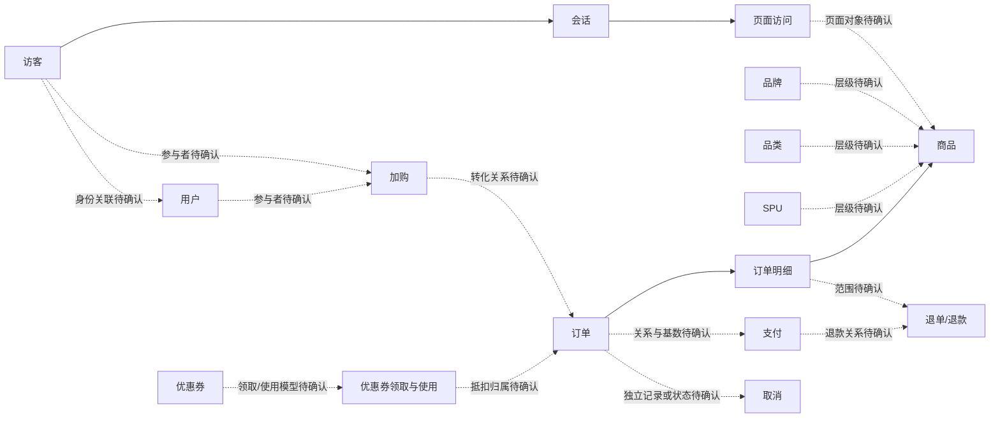

# Milestone 2 预设计评审包

版本：`0.1-draft`

状态：`draft`，待用户评审

更新时间：2026-09-04

适用决策：`DR-004`、`DR-005`

## 1. 使用目的与证据边界

本文档用于在 Milestone 1 为 `in progress`、Milestone 2 保持 `pending` 时，提前整理 Milestone 2 所需的业务过程、概念关系、指标依赖、验收场景和待确认决策。它是直接可编辑的评审输入，不是正式 OLTP 模型，也不表示已经进入 Milestone 2。

本文档只依据当前仓库的 `README.md`、`docs/spec.md`、`docs/plan.md` 和已接受决策，不引用旧仓库候选实现。当前没有执行 MySQL、没有创建业务表、没有生成固定数据，也没有验证任何主外键、状态迁移、金额或指标结果。

在本评审包通过前：

- 不创建或修改 `mysql/ddl/`、`mysql/seed/`、`mock/` 中的运行性内容。
- 不创建 `generator/`、`tests/`，不新增运行脚本或可执行接口。
- 不确定表名、字段名、字段类型、主外键、状态枚举、索引或物理存储设计。
- 不根据指标名称反推并采用业务规则；缺失内容统一标记 `DECISION_REQUIRED`。

## 2. 业务过程与正式指标需求矩阵

下表只说明 30 项正式指标需要哪些业务过程提供语义输入，不定义公式、时间归属、去重对象或过滤条件。

| 主题 | 待评审业务过程 | 关联正式指标 | 当前缺口 |
| --- | --- | --- | --- |
| 流量 | 渠道访问、会话开始与结束、页面访问、首页访问、商品详情访问 | `P1_METRIC_001` 各渠道独立访客数；`P1_METRIC_002` 各渠道会话总数；`P1_METRIC_003` 各渠道会话平均浏览页数；`P1_METRIC_004` 各渠道会话平均停留时长；`P1_METRIC_005` 各渠道跳出率；`P1_METRIC_006` 各小时独立访客数；`P1_METRIC_007` 各小时页面浏览数；`P1_METRIC_012` 首页浏览人数；`P1_METRIC_013` 商品详情页浏览人数 | 访客标识、会话边界、页面分类、事件时间和跨日规则均为 `DECISION_REQUIRED` |
| 用户 | 注册、登录、用户类型识别、新增、活跃、回流 | `P1_METRIC_008` 各类访客数；`P1_METRIC_009` 回流用户数；`P1_METRIC_010` 新增用户数；`P1_METRIC_011` 活跃用户数 | 用户与访客关联、用户类型、新增/活跃/回流定义均为 `DECISION_REQUIRED` |
| 交易 | 加购、下单、支付 | `P1_METRIC_014` 加购人数；`P1_METRIC_015` 下单人数；`P1_METRIC_016` 支付成功人数；`P1_METRIC_017` 新增下单人数；`P1_METRIC_018` 新增支付成功人数 | 加购/订单/支付粒度、成功状态、人数去重对象和时间归属均为 `DECISION_REQUIRED` |
| 商品与交易 | 品牌、品类、SPU 与订单明细的业务关联 | `P1_METRIC_019` 各品牌订单数；`P1_METRIC_020` 各品牌订单金额；`P1_METRIC_022` 各品类订单数；`P1_METRIC_023` 各 SPU 订单数；`P1_METRIC_024` 各 SPU 订单金额 | 商品层级、订单明细粒度、下单时属性快照和金额范围均为 `DECISION_REQUIRED` |
| 退单/退款 | 取消、退单、退款及其与订单、支付的关系 | `P1_METRIC_021` 各品牌退单数；`P1_METRIC_028` 退单数 | 退单与退款是否分离、计数对象、品牌归属和状态生效时间均为 `DECISION_REQUIRED` |
| 交易汇总 | 订单金额、订单数量、下单人数、收货省份 | `P1_METRIC_025` 订单总额；`P1_METRIC_026` 订单数；`P1_METRIC_027` 订单人数；`P1_METRIC_029` 各省份订单金额 | 有效订单范围、取消/退款扣减、地址时间点、金额精度和时间归属均为 `DECISION_REQUIRED` |
| 营销 | 优惠券领取、使用和补贴 | `P1_METRIC_030` 优惠券补贴率 | 统计窗口、分子、分母、金额范围、使用状态和零分母规则均为 `DECISION_REQUIRED` |

覆盖检查：上述矩阵仅覆盖 `P1_METRIC_001` 至 `P1_METRIC_030`。`P1_METRIC_031` 至 `040` 继续保持扩展候选，不进入本轮预设计；五项实时候选仍只保留既有编号，不定义实时语义。

## 3. 概念关系草案

下图只表达需要评审的概念关联，不表达物理表、基数、主外键或已采用事实粒度。所有连线均为 `draft`。

需要评审的概念对象：

| 概念对象 | 本阶段只确认什么 | 本阶段不确认什么 |
| --- | --- | --- |
| 用户、访客 | 是否为不同身份、关联方式、匿名转登录语义 | 表名、ID 类型、合并算法 |
| 会话、页面访问 | 会话边界、跨日处理、页面分类和事件时间 | 字段结构、埋点 Schema、实时窗口 |
| 品牌、品类、SPU、商品 | 层级、归属变化和订单时属性口径 | 维度表物理设计、拉链实现 |
| 加购 | 一次加购的业务含义、数量变化和去重对象 | 事件表 DDL、实时去重状态 |
| 订单、订单明细 | 一行代表什么、业务键、金额组成和生命周期 | 字段类型、索引和分区 |
| 支付 | 与订单关系、成功语义、重复回调处理 | 支付接口或第三方协议 |
| 取消、退单、退款 | 三者关系、作用范围、数量与金额守恒 | 最终状态枚举和 SQL |
| 优惠券领取与使用 | 领取、使用、失效和补贴归属 | 优惠券系统实现和正式公式 |

## 4. `DECISION_REQUIRED` 决策矩阵

以下决策必须由用户确认。候选方向只用于说明需要选择的边界，不表示推荐或采用。

| 编号 | 必须确认的决策 | 至少需要回答的问题 | 未确认时阻断 |
| --- | --- | --- | --- |
| `M2-DEC-001` | 用户与访客身份 | 匿名访客如何标识；登录前后是否合并；一个用户是否允许多个访客标识 | 用户、流量模型和人数指标 |
| `M2-DEC-002` | 会话边界 | 会话开始/结束依据；超时、跨日和渠道变化如何处理 | 会话、停留时长和跳出指标 |
| `M2-DEC-003` | 用户类型与新增/活跃/回流 | 各概念的观察窗口、事件来源和互斥关系 | `P1_METRIC_008` 至 `011`、`017`、`018` |
| `M2-DEC-004` | 商品层级 | 品牌、品类、SPU、商品之间的层级与变更语义 | 商品关系和品牌/品类/SPU 指标 |
| `M2-DEC-005` | 加购粒度 | 新增、改量、删除如何表达；一次加购和加购人数如何去重 | 加购模型和 `P1_METRIC_014` |
| `M2-DEC-006` | 订单与明细粒度 | 订单、明细各一行代表什么；业务键和拆单语义 | 订单 DDL、金额守恒和订单指标 |
| `M2-DEC-007` | 支付关系与成功语义 | 一单一次或多次支付；重复回调；成功人数的去重对象 | 支付模型和 `P1_METRIC_016`、`018` |
| `M2-DEC-008` | 取消、退单与退款关系 | 是否分离；作用于订单或明细；部分退与多次退如何表达 | 状态机、守恒和退单指标 |
| `M2-DEC-009` | 业务状态机 | 每个对象的合法状态、迁移、终态和非法迁移处理 | 正式状态枚举、约束和异常样例 |
| `M2-DEC-010` | 硬删除策略 | 使用软删除/状态字段，还是周期性全量快照与删除对账 | 增量抽取完整性和删除测试 |
| `M2-DEC-011` | 时间语义 | 各过程的事件时间、更新时间、业务日期、时区和跨日归属 | 源字段、分区和全部按日/小时指标 |
| `M2-DEC-012` | 金额与数量 | 币种、精度、舍入、含税/运费/优惠范围和负数规则 | 字段类型、金额守恒和金额指标 |
| `M2-DEC-013` | 优惠券补贴率 | 统计窗口、分子、分母、金额范围和零分母规则 | `P1_METRIC_030` |
| `M2-DEC-014` | 数据库约束与异常注入 | 哪些规则由数据库约束；非法数据如何在不破坏正常 seed 的情况下提供 | DDL 约束和异常验收数据 |
| `M2-DEC-015` | 验收数据集规模 | 固定数据覆盖多少对象、业务日期和边界组合 | seed 规模、预期结果和人工核对成本 |

## 5. 状态机评审框架

本节不提供任何状态值或迁移默认值。用户确认后，才为每个对象补充状态名称、起点、允许迁移、终态、触发事件、时间字段和非法迁移行为。

| 对象 | 必须确认的状态语义 | 必须覆盖的异常 |
| --- | --- | --- |
| 订单 | 创建、有效、取消、完成之间的业务边界 | 重复取消、终态后变更、无明细订单 |
| 支付 | 发起、成功、失败以及重复通知的业务边界 | 无订单支付、重复成功、成功后反向变化 |
| 退单/退款 | 申请、处理和完成是否分离，部分与多次处理规则 | 超数量、超金额、重复完成、跨明细错误 |
| 加购 | 新增、改量、移除是否作为状态或事件 | 非法数量、重复请求、无商品引用 |
| 优惠券 | 领取、使用、失效和撤销的关系 | 重复使用、过期使用、无领取记录使用 |

## 6. 固定验收场景矩阵

当前只确定场景目的和未来必须核对的不变量，不提供数据行、精确数量或指标结果。所有预期值必须在业务决策通过后补充。

| 场景编号 | 场景 | 未来固定输入必须覆盖 | 未来预期约束 |
| --- | --- | --- | --- |
| `M2-SC-001` | 正常闭环 | 注册或访客访问、浏览、加购、下单、支付 | 引用完整，状态和金额按确认规则守恒 |
| `M2-SC-002` | 订单取消 | 下单后发生允许的取消 | 生效范围和指标影响与确认规则一致 |
| `M2-SC-003` | 退单/退款 | 全量或部分退单/退款候选情形 | 数量与金额不超过确认边界，关系可追溯 |
| `M2-SC-004` | 重复业务请求 | 相同业务键或请求被重复提交 | 唯一性、幂等或保留重复的行为与确认规则一致 |
| `M2-SC-005` | 跨日过程 | 下单、支付、取消或退款分属不同业务日期 | 各过程按确认的事件时间和业务日期归属 |
| `M2-SC-006` | 非法状态迁移 | 从不允许的前态触发迁移 | 明确拒绝、隔离或记录方式，不污染正常数据 |
| `M2-SC-007` | 主外键缺失 | 订单无用户、明细无商品等候选异常 | 按确认的数据库约束与异常注入方式处理 |
| `M2-SC-008` | 空值边界 | 可空和不可空业务属性的候选样例 | 空值范围与正式字段规则一致 |
| `M2-SC-009` | 金额和舍入边界 | 小数精度、优惠、部分退款和零金额候选样例 | 按确认精度与舍入规则守恒 |
| `M2-SC-010` | 用户属性变化 | 用户或商品属性在业务过程前后发生变化 | 当前值或历史值归属与确认策略一致 |
| `M2-SC-011` | 零分母 | 没有符合分母条件但需要输出的候选日期或维度 | 输出行为由指标评审确认，不在本阶段默认 |
| `M2-SC-012` | 优惠券异常 | 重复使用、失效后使用或无订单使用候选情形 | 使用状态和补贴金额按确认规则处理 |

## 7. 用户评审顺序

按下列顺序评审，前一组未确认时不继续推导后续物理模型：

1. `P0` 身份与流量：确认 `M2-DEC-001` 至 `003`。
2. `P0` 交易核心：确认 `M2-DEC-005` 至 `010`。
3. `P0` 时间与金额：确认 `M2-DEC-011`、`012`。
4. `P1` 商品与营销：确认 `M2-DEC-004`、`013`。
5. `P1` 验收设计：确认 `M2-DEC-014`、`015`，再为 `M2-SC-001` 至 `012` 填写固定输入和预期结果。

## 8. 正式进入 Milestone 2 的检查表

只有以下项目全部满足，才能按 `docs/plan.md` 正式进入 Milestone 2：

- [ ] MySQL 已通过 Milestone 1 的启动和连接验证，并保留环境、版本、命令、退出状态和结果证据。
- [ ] `M2-DEC-001` 至 `M2-DEC-015` 中会阻断源模型的决策已由用户明确确认。
- [ ] 五个主题的业务过程边界通过评审。
- [ ] OLTP 表、字段、主外键、业务键和事实粒度已确认，但尚未以未评审草案冒充正式实现。
- [ ] 订单、支付、取消、退单/退款和优惠券状态机已确认。
- [ ] 硬删除、时间、金额、数量、精度和舍入规则已确认。
- [ ] 30 项正式指标所需业务过程全部可由确认后的源模型支持；指标公式仍可保持 `draft`。
- [ ] 固定验收数据的规模、业务日期和异常注入方式已确认。
- [ ] 正式实施范围、执行命令、预期结果、失败退出和回滚方案已准备进入下一轮实现。

当前结论：上述检查尚未完成，Milestone 2 继续保持 `pending`。本文档通过静态评审也不能提升 MySQL、业务模型或数据链路的证据状态。
