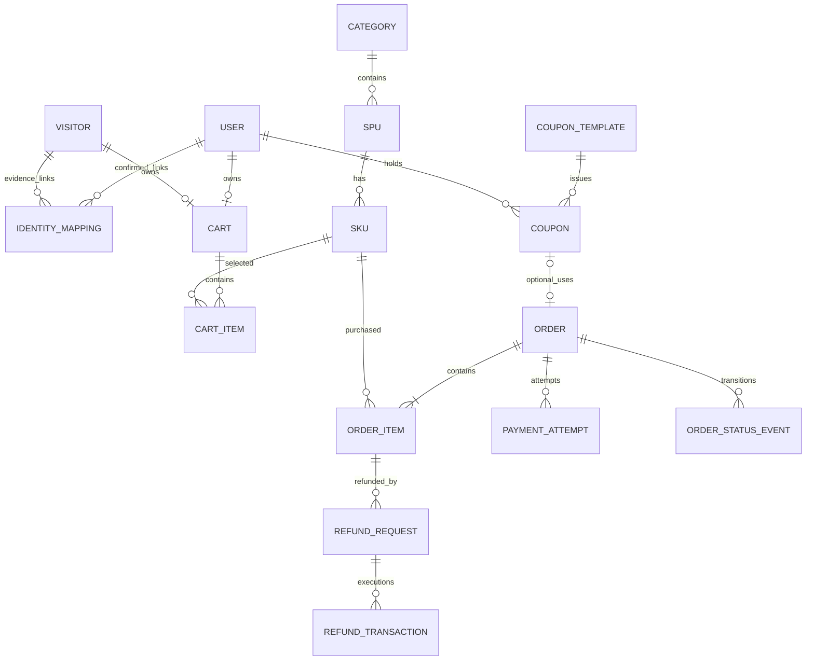

# 模拟自营电商业务源逻辑数据模型 V2.0

> 文档状态：业务源逻辑模型归档，2026-09-18。基于本对话逐轮确认的实体/关系、历史、金额、身份及模拟规则；**概念/逻辑实体 ≠ 一定与物理表一一对应**。物理落地请参见 [physical-model-v1.md](physical-model-v1.md)，旧 19 表候选实现不采纳。
> 此文不是 SQL，也不代表已部署或生成 90 天数据。

## 1. 模型范围及业务事件

交易 MySQL 保留当前状态+关键历史，通过 Binlog CDC 进入 Kafka；独立行为源写页面/商品/购物三组 Kafka Topic。业务域：用户身份、商品、购物车、订单、支付、退款、券，共 7 个物理分组目标 21 表；物流履约、库存流水、复杂营销及完整售后暂属二期。

| 概念 | 作用 | 关键对象/事件 |
|---|---|---|
| 用户与身份 | 匿名和注册身份独立、可靠关联与追溯 | 用户、访客、身份映射修订 |
| 商品 | 类目-SPU-SKU与价格/品牌/状态历史 | 商品当前状态及变更事件 |
| 购物车 | 匿名/账号购物车、按 SKU 合并与幂等 | 购物车、明细、合并记录 |
| 订单 | 冻结成交快照、状态变化与取消 | 订单、订单明细、订单状态历史 |
| 支付 | 一单多尝试、一次有效成功 | 资金尝试、支付变化事件 |
| 退款 | 一申请对应一明细、多执行尝试 | 退款申请、资金退款、退款历史 |
| 券 | 模板、领取实例、锁定与核销 | 券模板、实例、状态历史 |
| 行为事件流（不计入 21 表） | 独立浏览、曝光、点击、加购、移除 | 事件 ID、身份、session、业务发生时间 |

## 2. 概念 ER 核心关系

`CART` 的 USER/ VISITOR 所属为互斥二选一，不是双重归属；订单使用优惠券可选且至多一张；订单头与明细是一对多、每单 1~5 个不同 SKU；退款一申请只指向一明细，明细可有多次申请；每次退款申请可多次尝试但最终最多一次资金成功。图仅表达主要基数，不替代金额/状态/并发约束。

## 3. 逻辑主键、实体与必备属性

以下列举**指标与业务约束必需的逻辑属性**，在物理文档中对应具体字段类型及可空性。事件型记录必须分别保留 `event_id/event_key`、`occurred_at`（业务时刻）、`recorded_at`（记录时刻）；当前状态对象按适用情况保留 `created_at/updated_at`。

| 逻辑实体 | 唯一标识 | 必备属性 | 关联与历史 |
|---|---|---|---|
| USER | user_id；业务 user_key 唯一 | 用户状态、注册时间 | 身份、订单、券；用户变化由 CDC 留痕 |
| VISITOR | visitor_id；visitor_key 唯一 | 首次/最近出现时间 | 身份映射、游客购物车、行为 |
| IDENTITY_MAPPING | mapping_id；访客+版本受约束 | visitor/user、session 可选、证据类型/ID、作用范围、身份版本、有效期、撤销状态 | 只合并有可靠证据、歧义隔离、历史版本不可静默覆盖 |
| CATEGORY | category_id/code | 名称、状态、变更时间 | 1:N SPU；变更留历史 |
| SPU | spu_id/code | category、品牌编码/名称、商品名/状态 | 1:N SKU；类目品牌及状态变更留历史 |
| SKU | sku_id/code | spu、规格名称、销售单价、可售状态；库存属性的精确字段仍待物理收敛 | 下单价格快照；价格和状态历史 |
| PRODUCT_CHANGE_EVENT | change_id、event_key | target_type/id、变更类型、before/after、有效/记录时间 | 多态关联；不得伪造普通 FK |
| CART | cart_id；用户或游客当前车唯一 | 所有者、创建/更新时间 | 一人或一游客一辆当前车，两个所有者互斥 |
| CART_ITEM | cart_item_id；(cart_id,sku_id) 唯一 | SKU、quantity 1~99 | 按 SKU 合并/移除，状态与行为日志区分 |
| CART_MERGE_RECORD | merge_id；operation_id 唯一 | 源/目标购物车、user、SKU 合并详情、截断件数、时间 | 原子合并，重复 operation_id 不二次叠加 |
| ORDER | order_id；order_no 唯一 | 身份、券可选、状态、原价/优惠/应付、创建/付款截止/支付/取消时间 | 头金额与明细和一致；状态历史同事务 |
| ORDER_ITEM | order_item_id；(order_id,sku_id) 唯一 | 成交 SKU/SPU/类目/品牌/名称快照、数量、单价、原价、优惠分摊、应付、退款预留/成功金额、成功退款数量 | 单明细累计退款金额/数量限额 |
| ORDER_STATUS_EVENT | order_event_id；event_key 唯一 | order、CREATE/PAY/CANCEL、原新状态、发生/记录时间 | 不可变关键历史 |
| PAYMENT_ATTEMPT | attempt_id；order+attempt_no、funding_txn_id 唯一 | order、金额、INIT/FAILED/SUCCESS、发起/成功时间 | 一单多次执行，仅一次有效成功 |
| PAYMENT_EVENT | payment_event_id；event_key/回调 ID 幂等 | attempt、from/to、资金发生/记录时间 | 回调重复不创建第二笔有效支付 |
| REFUND_REQUEST | request_id/no 唯一 | order、**单一 order_item**、金额、明确数量可空、申请状态和时间 | 该申请完整成功或失败；额度预留 |
| REFUND_TRANSACTION | txn_id；申请+尝试序号及资金退款 ID 唯一 | request、金额、INIT/FAILED/SUCCESS、发起/成功时间 | 失败重试为新尝试；一申请最多一个成功 |
| REFUND_EVENT | refund_event_id；event_key 唯一 | request、txn 可选、事件类型、前后状态、时间 | 申请和资金执行的关键历史 |
| COUPON_TEMPLATE | template_id/code 唯一 | 面额、满额、有效期、发放上限、模板状态 | 一模板多券实例；首期订单级简单优惠券 |
| COUPON | coupon_id/code 唯一 | template、user、UNUSED/LOCKED/USED/EXPIRED、锁定/使用订单、领取及各状态时间 | 一订单最多用一券；USED退款不返 |
| COUPON_EVENT | coupon_event_id；event_key 唯一 | coupon、order 可选、ISSUE/LOCK/USE/UNLOCK/EXPIRE、前后状态、时间 | 事务原子更新与历史 |

**明确设计缺口**：原初业务约定“SKU 独立价格和库存”，但最新 21 表字段候选仅明确价格、未列库存字段；候选 DDL 部署前必须明确第一期 SKU `stock_quantity` 是否仅作为简单属性以及是否扣减（不扩展为库存流水）。此处不擅自把库存能力声明为已实现。另一差异是物理最新方案 `biz_spu.brand_code/brand_name`，无独立品牌表；逻辑品牌属性仍可用于订单快照与维度建模。

## 4. 业务状态与事件契约

| 对象 | 起点/状态迁移 | 事件及不变量 |
|---|---|---|
| 订单 | `CREATED→PAID` 或 `CREATED→CANCELED` | 15min 有效窗口；已 PAID 不能取消；退款不改变为 CANCELED |
| 支付尝试 | `INIT→FAILED/SUCCESS` | 新重试=新尝试与 funding_txn_id；一单≤1有效 SUCCESS；重复通知幂等 |
| 退款申请 | `REQUESTED→PROCESSING→SUCCESS/FAILED`（逻辑阶段） | 一申请单明细、资金最终完整成功或失败；申请额度及成功额度守恒 |
| 退款尝试 | `INIT→FAILED/SUCCESS` | 一申请可重试但≤1 SUCCESS；成功金额等于申请金额 |
| 优惠券 | `UNUSED→LOCKED→USED`，取消释放 `LOCKED→UNUSED/EXPIRED` | 有效锁定覆盖订单剩余 15min 支付窗口；USED 后退款不返 |
| 身份 | 可靠映射生效/撤销/修订 | 记录证据、版本、有效期；不强并不同账号 |
| 商品 | 价格/类目/品牌/状态变化 | 当前状态和 before/after 事件同事务；订单快照不可被后续商品更新覆盖 |
| 购物车 | 加购/移除/数量更新/登录合并 | 单 SKU ≤99；超额截断并留记录；重复 merge operation 幂等 |

`REQUESTED/PROCESSING/...` 是物理模型 V1.0 的候选状态集合，并非独立售后审核系统已经建成。全部跨表更新要在 MySQL 事务中产生对应不可变事件；CDC 读取**业务表和历史表**，无需新增 Outbox，也不允许数据库与 Kafka 应用双写。

## 5. 业务过程矩阵（用于后续维度模型）

| 业务过程 | 用户/匿名身份 | SKU | 订单 | 优惠券 | 时间与核心数量/金额 |
|---|---|---|---|---|---|
| 注册/登录映射 | 必须/按适用 | — | — | — | 注册/证据时间、身份版本 |
| 页面浏览/曝光/点击 | 必须有可用匿名身份 | 曝光点击有 SKU | — | — | event_time、event_id、session_id |
| 加购/移除 | 游客或用户 | 必须 | — | — | 数量与 event_time |
| 创建订单 | 游客或用户按既定归属 | 明细必须 | 必须 | 可选 | 创建日、金额快照及明细件数 |
| 取消订单 | 订单身份 | 从订单关联 | 必须 | 可选 | 取消时间；回修原创建日 GMV |
| 支付尝试/成功 | 从订单关联 | 从订单明细关联 | 必须 | 从订单关联 | 资金交易 ID、尝试、成功时间和金额 |
| 退款申请/执行 | 从订单关联 | **关联单明细** | 必须 | 从订单关联 | 申请/成功时间、退款金额、明确数量 |
| 优惠券领取/锁定/核销 | 券所属用户 | — | 锁定/核销时 | 必须 | 券实例、事件 ID 和事件时间 |
| 商品变更 | — | SKU 或 SPU/类目 | — | — | 属性 before/after、effective_at |

## 6. 行为事件统一逻辑契约（不落 21 MySQL 表）

最小字段：`event_id`（全局幂等）、`event_type`（PAGE_VIEW/PRODUCT_EXPOSURE/PRODUCT_CLICK/ADD_CART/REMOVE_CART）、`event_time`（毫秒、Asia/Shanghai 解释）、`ingest_time`（进入链路时刻）、`visitor_id`、`user_id?`、`session_id`、`sku_id?`、`page_id?`、`quantity?`、`identity_version?`（回算关联时使用）。这里的字段名为**逻辑契约提议**；精确 JSON Schema、可空性、跨 Topic key、Topic 保留时长待实施设计确认。

- 页面组：page_view；商品组：exposure/click；购物组：add_cart/remove_cart。三组跨 Topic 合并依据 `event_id`、时间、统一身份与 `session_id`，不是假设跨 Topic 存在全局顺序。
- Session 按同 visitor 的事件时间间隔 >30min 开新会话；迟到事件需重新判定受影响区间并版本化修订。
- 购物车行为日志用于行为漏斗；购物车 MySQL 状态表用于当前状态，不按二者重复统计成交。

## 7. 资金/时间/去重的一致性规则

1. 金额统一非浮点，交易金额以**分**精确表示；`order.gross = Σ(item.unit_price×quantity)`、`order.payable = gross−discount = Σ(item.payable)`。
2. 一笔订单最多一次有效支付 SUCCESS，重复通知不改变成功金额；一笔退款申请最多一次完整成功，累计成功退款 ≤ 对应明细券后应付。
3. 实际退款数量可空；只有明确数量且退款成功才增加 refunded_quantity，严禁按金额推算。
4. 日归属：订单创建、支付成功、退款成功、行为事件等各自业务时间；跨天取消回冲原下单日 GMV，跨天退款计退款发生日现金流并影响原订单群组净额。
5. 同批订单支付率是订单群组口径；7 日群组漏斗从入口事件起 7×24h；30 日退款标准群组按订单创建后 30 天并标记成熟程度。
6. 身份映射版本是 UV 与漏斗的输入依赖。被修订窗口需保留 as_of、版本与修订原因。

## 8. 指标所需字段覆盖矩阵

| 指标模块 | 基础来源 | 必需逻辑字段 |
|---|---|---|
| 交易 GMV/下单数 | ORDER、ORDER_STATUS_EVENT | order_id、created_at、payable、gross、discount、取消时刻/有效状态 |
| 付款与净额 | PAYMENT_ATTEMPT/EVENT、ORDER | order_id、funding_txn_id、SUCCESS、succeeded_at、amount |
| 商品销量与金额 | ORDER_ITEM、SKU/SPU/类目快照、PAYMENT | item_id、sku_id、quantity、分摊应付、paid_at、成交维度快照 |
| PV/UV/漏斗 | 行为流、IDENTITY_MAPPING、ORDER/PAYMENT | event_id、event_type/time、visitor/user/session、identity_version、order_id |
| 用户新客/首购 | USER、PAYMENT | user_id、registered_at、first valid succeeded_at |
| 退款/退款率 | REFUND_REQUEST/TRANSACTION、ORDER/ITEM | request_id、item_id、amount、明确数量、SUCCESS 时间、订单创建日 |
| 营销 | COUPON_TEMPLATE/COUPON/EVENT、ORDER/PAYMENT | coupon_id、状态事件时间、order_id、discount、有效支付 |
| SCD2 商品维度 | SKU/SPU/CATEGORY、PRODUCT_CHANGE_EVENT | 商品键、变化前后属性、effective_at、recorded_at |

## 9. 造数依赖与验收顺序

生成依赖：Category→SPU→SKU；User/Visitor→有证据映射→Cart/券实例；订单依赖 SKU 当前价与可售状态、身份及可选券；支付依赖已创建有效订单；退款依赖有效成功支付和具体订单明细。行为按跨日时间生成并关联真实身份/session、有效商品和订单链路。

新 Generator 不建设独立的约 100 单 Smoke 数据档位。正式数据规模使用显式 Seed，直接覆盖失败支付、重复通知、跨天取消、全额和金额补偿退款、优惠券过期锁定、商品改价、身份歧义、购物车溢出、故障后的新订单；业务验收通过后再生成独立性能实验规模。验收顺序为：字段/主键→跨表金额→状态事件一致性→指标源覆盖→可复现→快照与 CDC 接续→规模性能。

## 10. 物理转化前的审查门槛

需要单独确认：SKU 库存最小字段、订单匿名归属互斥规则的精确 CHECK、支付/退款异步回调去重保留范围、状态 JSON 的可演进契约、行为 Kafka Schema 和备份策略。券与订单已选定 `biz_order.coupon_id` 单向物理 FK，券表反向订单引用由索引与 Source Gate 校验。以上是物理/实施问题，**不应反向修改已经确定的业务事实和指标口径**。
